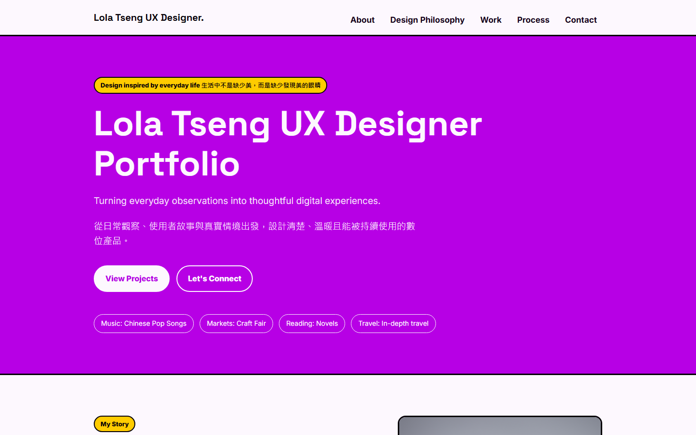
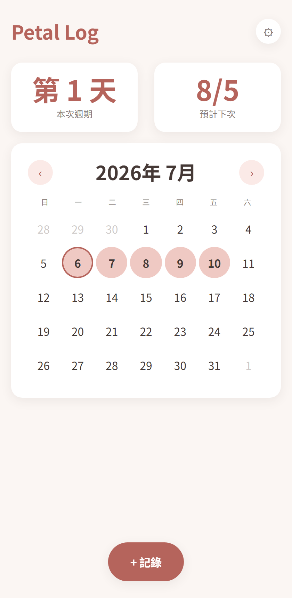
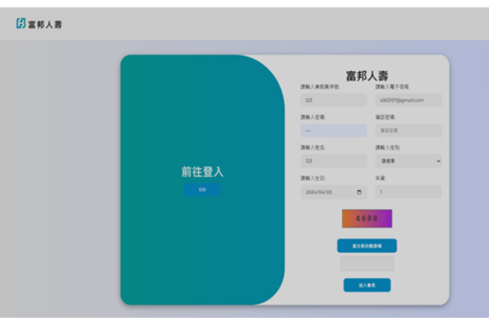
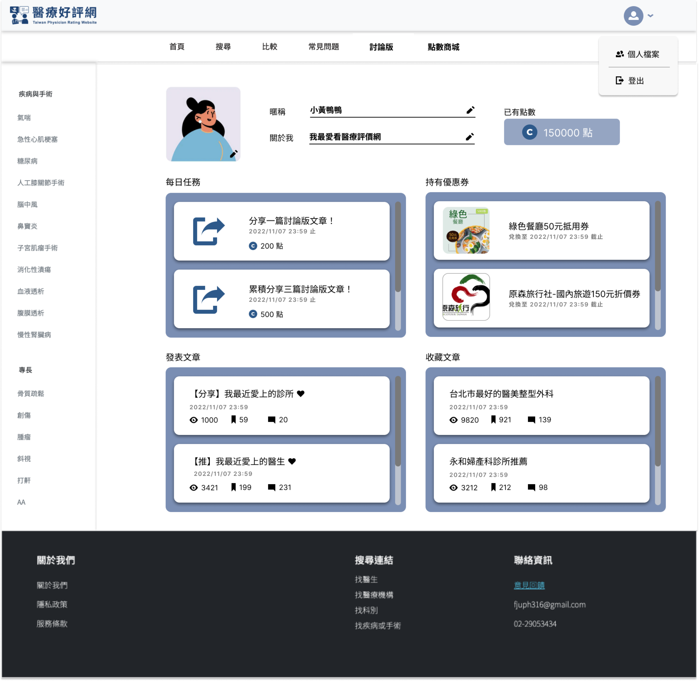
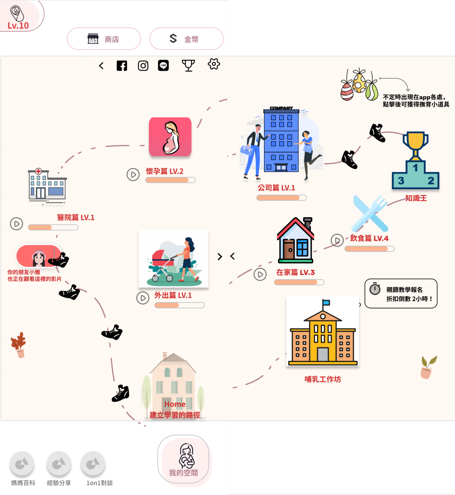
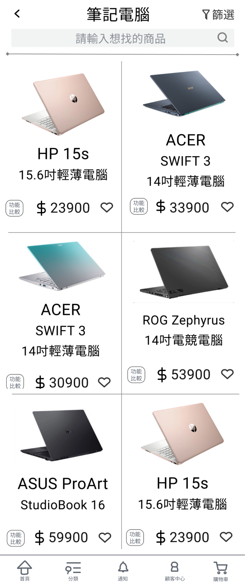

# Lola Tseng UX Designer Portfolio

> Design inspired by everyday life

Defining problems through user research, then shipping them into real products with AI collaboration.

Rooted in everyday observations, real user stories, and honest context — designing digital products that are clear, warm, and built to be actually used, not just handed off as a design file.

**4 UX Case Studies・InnoConnect+ Gold Award・2 AI-Collaborated Products Shipped**

- [View Projects](#work)
- [Let's Connect](#contact)
---

## Vibe Coding Projects {#vibe-coding .projects}

> Built end-to-end with AI

### Portfolio System

Content-managed in Markdown and turned into a live site by a **custom build script**, keeping updates simple and visually consistent.

#MarkdownCMS #StaticSiteGenerator #AICollaboration

### Petal Log

A minimal period-tracking site built by combining UX methods with **AI Vibe Coding** — from prototype straight to a shipped MVP.

#VibeCoding #UserResearch #MVP

---

## Work {#work .projects}

> Selected projects

### 尋保家 Quest for Home Safety

Built an AI-assisted insurance interface with an industry mentor, using a **decision tree** to help agents match clients to the right product faster.

#DecisionTree #InsurTech #AIRecommendation

### 醫療好評網 Taiwan Physician Rating Website

Shipped a healthcare platform prototype and validated its navigation structure through **usability testing with 3 users**, improving search task success.

#UsabilityTesting #AgileDevelopment #UserResearch

### 衛了教你餵母乳 The Nurture Way

Designed a gamified breastfeeding-education app using the Octalysis framework to keep users engaged — won the **InnoConnect+ Gold Award**.

#GamifiedDesign #Octalysis #ServiceDesign

### 電商平台介面優化 Innovation and Design Thinking

Redesigned an e-commerce comparison feature, lifting task completion to **97%** and significantly improving information clarity.

#ServiceBlueprint #UsabilityTesting #EcommerceUX

---

## About {#about .about}

> My Story

### About me

I define problems through user research, then use AI collaboration to turn the design into a product that actually ships — that's how I'd position myself right now.

When making decisions, I like to think through several directions on my own first, then talk it through with others, converging on an answer from where those views overlap; once I truly believe in something, I won't settle for a lukewarm compromise — I'd rather take the time to make the case until the consensus lands where I originally thought it should.

Friends tease me for "having a lot of stuff," but there's always a system behind how it's arranged — that instinct to want to collect everything, but keep it organized, is probably also why I fell into information architecture in the first place.

In design, I believe understanding the real need matters more than rushing to a solution; prototypes should be fast, technology should stay mostly invisible, and good experiences are usually hiding in small everyday details.

#### Skills

- UX Design
- User Research
- Prototyping
- Service Design
- AI-Assisted Development
- Frontend Implementation

---

## AI Learning Journey {#ai-learning .ai-journey}

> Continuous learning

### Mastered: Vibe Coding in Practice

Built two real, shipped products from zero to one — this portfolio site and Petal Log — covering the full loop from clarifying requirements to interface design to frontend implementation.

### In Progress: Systematic Deepening

Started the Google Digital Talent Exploration Program and the Claude 101 course in parallel from June 2026, turning one-off Vibe Coding experience into a method that's repeatable and extensible.

### Human-AI Collaboration Mindset

I treat AI as a discussion partner: think through the problem framing first, then let AI generate content; if the result doesn't match what I expected, I change the angle of my prompt and iterate, rather than scrapping it and starting over. That's also why I pay close attention to the misunderstandings and off-target answers AI commonly gives — that's actually a human-AI interaction problem worth designing a solution for. Rephrasing the question from a different angle usually finds the answer, rather than it just being a case of "the AI isn't smart enough."

---

## Journal {#journal .journal}

> Design notes

### Gamification Isn't a Universal Formula: What I Learned About the Octalysis Framework from The Nurture Way

2026.07

---

## Process {#process .process}

> Design process

1. Observe
2. Research
3. Define
4. Ideate
5. Prototype
6. Test
7. Iterate

---

## Contact {#contact .contact}

> Let's talk

### Hi Lola, I want to tell you...

Feel free to reach out about collaboration, portfolio feedback, or any product questions on your mind.

- [Email me](mailto:lola.jy.tseng@gmail.com)
