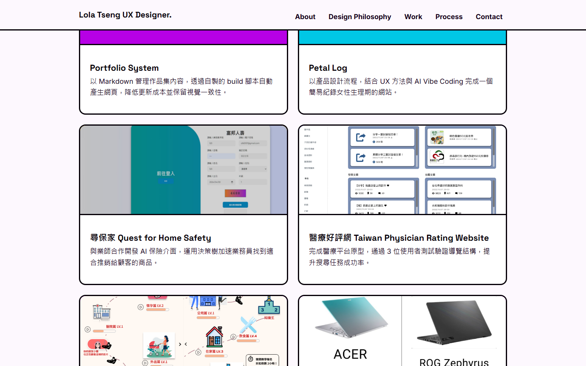
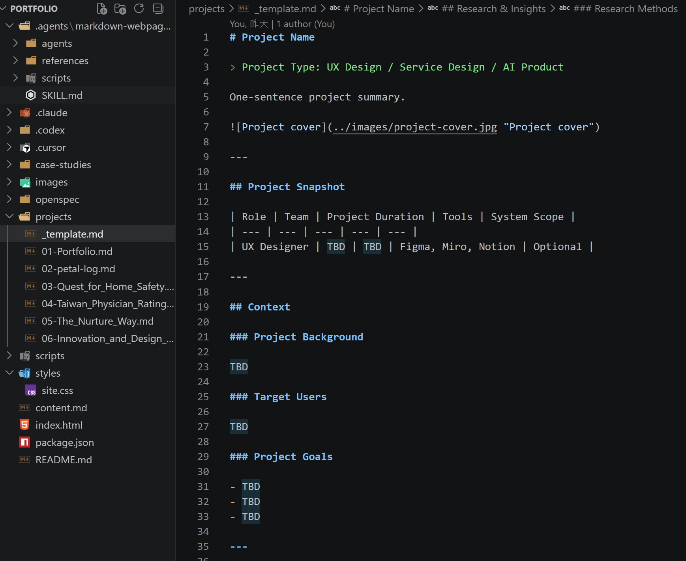

# Portfolio System

> Project Type: UX Design / Frontend

I manage my portfolio content in Markdown and use a custom-built build script to automatically generate the website, reducing the cost of updates while preserving visual consistency.

---

## Project Snapshot

| Role | Team | Project Duration | Tools | System Scope |
| --- | --- | --- | --- | --- |
| Product Designer / AI Builder | Personal project | 2026.07 – Present | HTML, CSS, Markdown, AI collaboration | Portfolio website (homepage + case study pages) |

---

## Context

### Project Background

When I used to hand-code my portfolio in pure HTML, adding a new case study meant duplicating an entire page, and any change to the shared navigation bar, footer, or layout meant checking and editing six or seven files one by one — an approach very prone to missed edits and inconsistencies. This project set out to separate "content" from "layout": text and images live in Markdown, while the layout logic is centralized in a single build script, making the portfolio far simpler to maintain.

### Target Users

- Myself (content maintainer): needs to be able to quickly add and edit project content without repeatedly touching HTML/CSS.
- Portfolio visitors (recruiters, interviewers, collaborators): need to be able to quickly browse the project list and then dive into a full case study.

### Project Goals

- Write each project's content in Markdown so layout changes don't require editing every page's HTML
- Keep six or more case study pages consistent in layout structure and visual style
- Make adding a new project as simple as possible: copy the template, fill in content, run the build once

---

## Research & Insights

### Research Methods

- Reviewed the actual maintenance problems I ran into with my previous hand-coded HTML portfolio
- Looked at static site generators to extract the core "template + content" concept, then scaled it down to a simplified version suited to a single maintainer working on a small site

### Key Findings / Main Problems

- Content and layout were mixed together in the same HTML file, so even a simple text edit meant hunting through a mass of tags to find the right spot — easy to break something
- The shared layout across six case study pages (Snapshot, Research, Process...) was prone to inconsistency whenever a single page was hand-edited and something was missed

### Key Insights

- Although the six case studies cover different topics, their skeletons are highly similar (Snapshot / Context / Research & Insights / Design Process / Solution / Impact / Reflection), making them well suited to auto-generation from a single shared rule set
- Mapping Markdown heading levels and a handful of syntax conventions (like `{#id .class}`) to a fixed HTML template achieves "content-driven layout" without introducing a frontend framework

### Design Opportunities

- Design a set of Markdown syntax conventions to replace hand-written HTML: `##` maps to a main section, `###` maps to a card or subsection heading
- Have the homepage Work cards' links auto-match each case study's title, rather than manually pasting URLs

### How This Influenced the Design

These observations led me to skip adopting a full frontend framework, and instead, working with AI collaboratively, convert Markdown blocks (headings, lists, tables, quotes, images) one by one into fixed HTML templates, using class names (such as `.about`, `.projects`, `.process`) to control which layout gets applied.

---

## Design Process

### Process Overview

I broke down what the build script actually does into step cards, so the decision point of "choosing a layout by class" is easy to spot within the overall flow at a glance.

1. **[SYS] Write Markdown content** — Homepage content lives in content.md, and the six case studies live in projects/*.md, sharing the same heading-level and `{#id .class}` syntax conventions.
2. **[SYS] build.js parses blocks** — Goes line by line to identify headings, lists, tables, quotes, and images, converting them into a structured block array.
3. **[ENGINE] Select the matching layout by class** — Homepage blocks are dispatched to different render functions based on class; case study pages always apply the same fixed template, with no class check needed.｜Homepage blocks=>Dispatched to the corresponding render function based on classes such as .about / .projects / .ai-journey / .process / .playground / .journal / .life / .contact.｜Case study page blocks=>No class check; always output the fixed seven sections — Snapshot, Context, Research & Insights, Design Process, Solution, Impact, Reflection.
4. **[OUTPUT] Output static pages** — Writes to index.html and case-studies/*.html; `npm run dev` additionally provides local live preview with auto-reload.

### Information Architecture

The site has two layers: the homepage (`content.md` → `index.html`, containing About, Design Philosophy, Work, Process, Contact) and case study pages (`projects/*.md` → `case-studies/*.html`, each containing Snapshot, Context, Research & Insights, Design Process, Solution, Impact, Reflection). All pages share the same `styles/site.css` to ensure visual consistency.

### Prototype

I first wrote a `_template.md` defining the fixed section order for case study pages; every subsequent project was written against this template, which also serves as the basis the build script uses to determine block types.

### Key Design Decisions

- Used numeric filename prefixes (01–06) to maintain project order in the listing and in the previous/next navigation
- Mapped heading levels to layout roles, and embedded images directly with Markdown image syntax rather than writing separate HTML
- Generated the homepage Work cards' links by auto-matching card titles to each case study's title, falling back to sequential order only when no match is found

---

## Solution

### Final Solution

Completed a reusable build script (`scripts/build.js`) that converts `content.md` and `projects/*.md` into a visually consistent static website, with support for `--watch` auto-rebuild and `--serve` local live preview.

### Main Features

- Markdown-driven content: adding or editing a project only requires editing a single `.md` file
- Auto-generated "previous/next" navigation links for each case study
- Homepage Work cards automatically link to the correct case study URL
- `npm run dev` (`--watch --serve`) supports local live preview with auto-reload

### Key Screens

The homepage is centered on the theme "Design inspired by everyday life," greeting visitors with a self-introduction and entry points into the work as soon as they land.

The six projects are presented as cards; clicking a card takes you to the corresponding case study page. The card layout fully shares the same CSS, so no separate layout work is needed for new projects.

All case study pages share the same template (Snapshot, Context, Research & Insights...); the only difference is the Markdown content itself.

### Design Rationale

I chose to write my own script rather than adopt an existing static site framework because the overall scope was small and the requirements simple (six case studies plus one homepage) — writing a dedicated conversion script directly was cheaper than adopting and learning a full framework, and made it easier to customize layout rules to my own needs.

---

## Impact

### Testing Approach

Used `npm run dev` to continuously preview build output locally, checking after every Markdown edit that all six case study pages and the homepage stayed visually consistent and that images and links were correct.

### Results

- Adding or updating a project went from "hand-coding a full HTML page" to "editing one Markdown file and running the build once"
- All six case study pages share the same layout logic and CSS, maintaining a consistent visual style

### Future Improvements

- Add automatic image compression/responsive sizing to avoid manually managing oversized image files
- Add simple content checks that flag project files missing a cover image or a required section

---

## Reflection

### What Went Well

The decision to separate "content" from "layout" meant that writing the remaining five project case studies never required touching HTML/CSS again — I could just focus on writing Markdown.

### What I Would Do Differently

Standardizing image folder and filename conventions from the start (e.g. always using a project's English codename, no spaces, consistent casing) would have saved a lot of later rework fixing image paths one by one.

### Key Learnings

- The core concept behind static site generators: one template plus structured content is enough to repeatedly produce pages with a consistent style
- Image paths and filename casing behave differently between local (Windows) and production (GitHub Pages, Linux) environments — this convention should be standardized at the design stage, rather than discovered only after images fail to display post-launch

### Skills Demonstrated

- Built a simple Markdown → HTML conversion tool through AI collaboration
- Information architecture planning: shared templates plus differentiated content
- CSS design system maintenance: a single stylesheet shared across multiple pages
