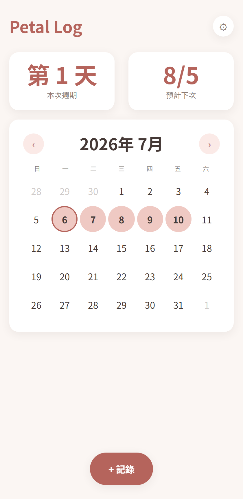
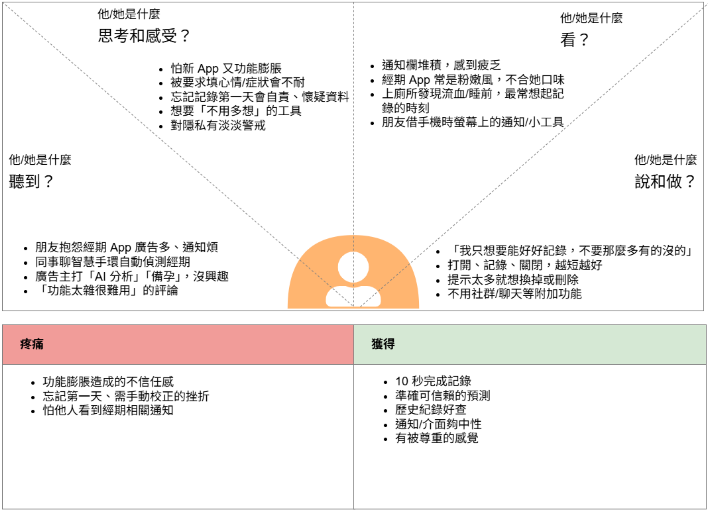
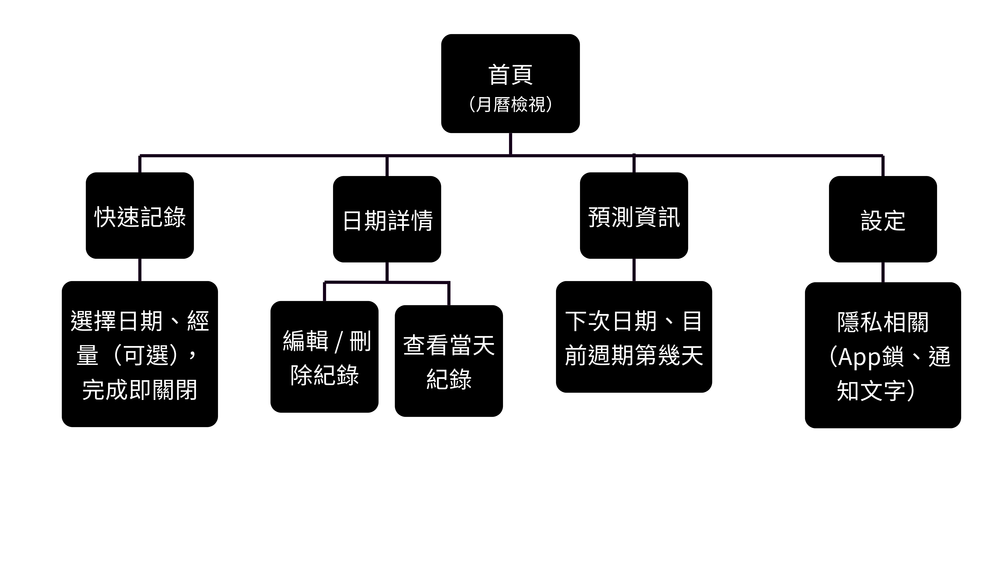
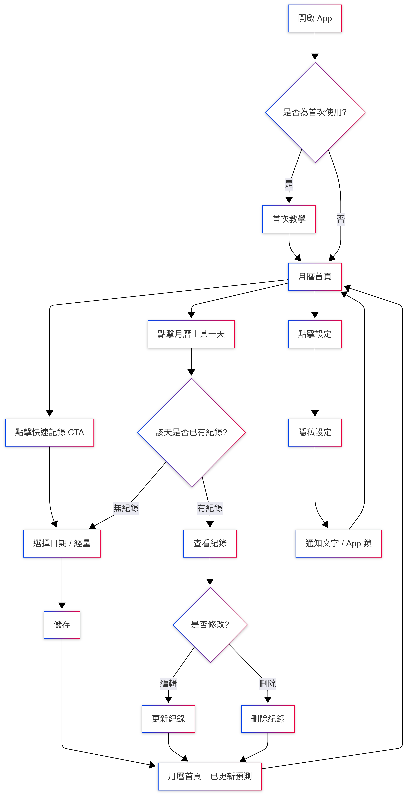
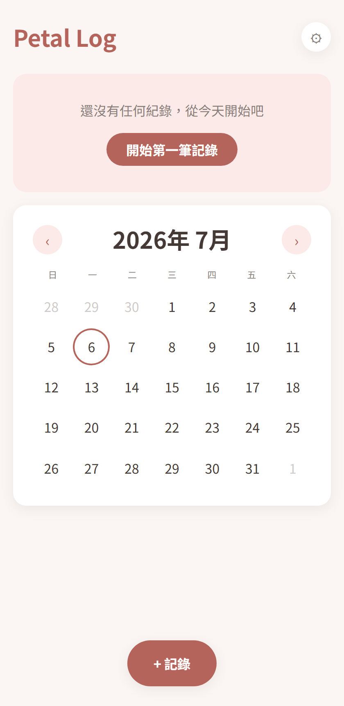
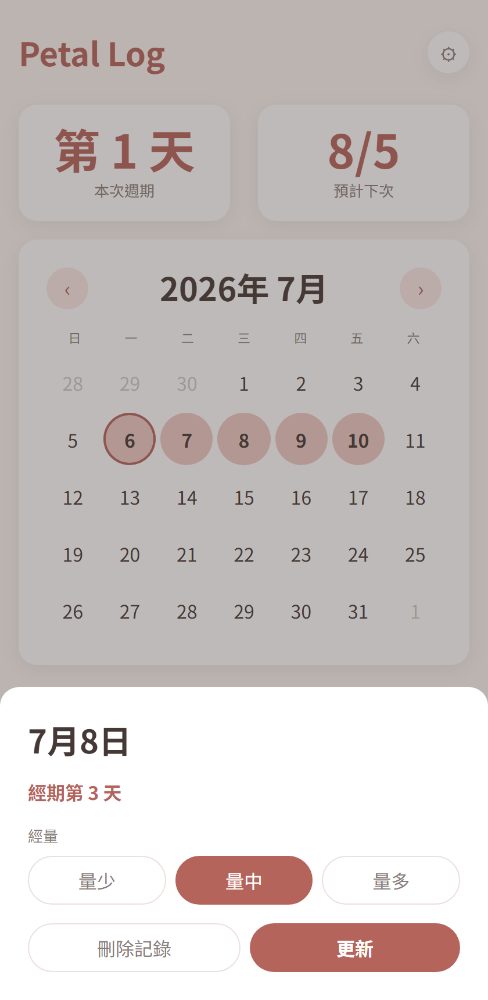
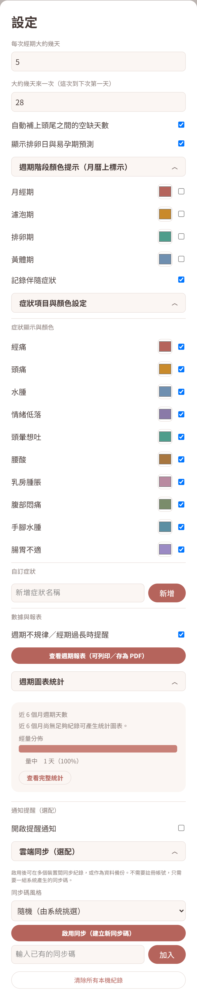

# Petal Log

> Project Type: UX Design / AI Product

Petal Log aims to be a menstrual cycle tracking tool that is "quick to log, clear in its predictions, gentle to use, and privacy-conscious," helping women build a tracking habit more easily and understand their body's rhythm.

---

## Project Snapshot

| Role | Team | Project Duration | Tools |
| --- | --- | --- | --- | --- |
| Product Designer / AI Builder | Solo Project | 2026/07 - Present | Design Thinking, Figma, AI Coding Tools |

---

## Context

### Project Background

As awareness of women's health has grown, more and more people have started using menstrual cycle tracking tools. However, products on the market have gradually piled on features—pregnancy planning, symptom analysis, health reports, community interaction—turning what used to be a simple logging process into something complicated.
For many users, what they actually need is just to quickly log their period and get a reliable cycle prediction.
So I wanted to design a period-tracking experience that focuses on core needs and reduces the burden of use.

### Target Users

- Primary User

Ages 20–35

Has a regular menstrual cycle

Has used a period-tracking app before

But feels it's:
1. Too complicated
2. Too many ads
3. Too many features
4. Just wants to log quickly

- Secondary User

Ages 18–25

First time using a period-tracking app.

Needs:
1. Simple
2. Easy to understand
3. No pressure

- Out of Scope (for now)

For example:
1. Pregnancy tracking
2. Trying to conceive
3. Menopause
4. Multi-user sharing
5. Medical use

### Project Goals

- **Build a period-tracking product with a strong brand feel that's easy to keep using.**
- Complete a log entry within 10 seconds, reducing the pressure of tracking
- Lower the learning curve and build a lasting usage habit
- Provide trustworthy cycle predictions that can be understood at a glance

---

## Research & Insights

### Research Methods

- Persona
**Primary Persona**

Nickname: Yu-Wei
Age: 27
Location: Taipei City
Occupation: Marketing Planner

Background: She's been using period-tracking apps for three or four years now, cycling through two or three different ones. Each one felt fresh at first, but after a while she'd notice the feature creep—pregnancy reminders, health reports, community feeds—crowding the interface until she wanted to find something that "just does tracking, plainly."

Personality & Values: She values efficiency and dislikes anything drawn-out, believing a tool should do one thing well. At work she's used to making quick judgment calls and executing fast, so any unnecessary extra step in an interface makes her impatient.

Interests & Preferences: She likes minimally designed products (notebooks, apps, home goods) and prefers a neutral visual style—not overly cute or pink.

Needs & Goals: Log an entry within 10 seconds; accurate predictions for her next period; the ability to quickly look back at past records when needed (e.g., before a doctor's visit).

Motivation: She wants to escape the experience of being "held hostage by features" and regain a simple, controllable tracking habit.

Pain Points & Challenges: She often only realizes she's started bleeding after using the bathroom, or remembers to log it only when getting ready for bed after a shower—if the flow is too long, she'll just skip it. She occasionally forgets which day was day one, and if logging it retroactively is too much trouble, she'll simply lose confidence in that record.

Concerns & Objections: She's skeptical of "yet another new app"—worried it will soon start piling on features and ads again, turning into exactly the kind of thing she's trying to escape. She's also concerned that if a friend borrows her phone, they might accidentally see a notification or widget content.

Potential Solutions: A minimal, single-screen quick-log entry point; no forced mood or symptom fields; neutral icons and wording for notifications and widgets; history and editing that are just as effortless to use.

Communication Preferences: Interface copy should be concise and direct, without extra encouragement or a cutesy tone. She likes feedback that's "done is done"—no need for extra ceremony.

Real Quote: "I don't need an app to remind me how I'm feeling. I just want to know what day I'm on and when the next one is."

**Secondary Persona**

Nickname: Xin-Yu
Age: 19
Location: Hsinchu City
Occupation: Sophomore college student

Background: She's never had a habit of tracking her period. This time she's starting to try it because a friend recommended it, and she's still figuring out "how to log it" and "what's the point of logging it."

Personality & Values: She tends to get anxious about health-related matters and worries about being "not normal." She values privacy and doesn't want family or friends to find out she's using this kind of app.

Interests & Preferences: She's active on social media and likes a visual style that's soft and cute without being childish. First impressions of an interface matter a lot to her.

Needs & Goals: She wants to understand her own cycle patterns, especially "why this one came early/late." She wishes someone (or the interface) could simply tell her "this is what you should do."

Motivation: She wants to better understand her own body and reduce her uncertainty and anxiety about her period.

Pain Points & Challenges: When an interface is too bare or too minimal, she becomes unsure whether "the entry actually saved." When she forgets to log, she tends to doubt herself ("Am I just not disciplined enough?"), and in bad cases she considers giving up on the app entirely.

Concerns & Objections: She worries that if a family member borrows her phone, the app icon or notification content could reveal that she's using a period-tracking app. She's also concerned about whether her health data might leak.

Potential Solutions: A gentle empty-state prompt on first use to guide her through her first entry; gentle copy when she forgets to log (e.g., "No worries, just log it now" rather than flagging a failure); a neutral, low-profile icon and notifications.

Communication Preferences: The tone should be gentle, like a friend talking to her, avoiding clinical or lecturing language. She needs a little affirmation and guidance, but not overly frequent prompts that interrupt her.

Real Quote: "I just want to know whether I'm normal. I don't want an app that makes me feel like a failure."

- Empathy Map

### Key Findings / Main Problems

| Needs | Why |
| --- | --- |
| Quick logging | Doesn't want to spend a lot of time each time |
| Next-cycle prediction | To prepare in advance |
| View history | Convenient for doctor visits |
| Privacy | Doesn't want embarrassment |
| Simple UI | Only used a few times a month, doesn't want to relearn it |

### Key Insights

- HMW: How might we design a period tracker that lets users log an entry within 10 seconds, while ensuring a minimal interface, intuitive predictions, and strict privacy encryption?
- What users need isn't more features—it's fewer steps.

### Design Opportunities

- Quick logging
- Clear calendar presentation
- Gentle reminders
- Simple predictions

### How This Influenced the Design

Once the personas and empathy map were laid out, it became clear that the primary persona (Yu-Wei) and secondary persona (Xin-Yu) actually define "simple" in contradictory ways: Yu-Wei wants "strip away every unnecessary step," while Xin-Yu wants "a bit of guidance to feel reassured." If the interface went fully minimal with zero prompt text, it would satisfy Yu-Wei but leave Xin-Yu lost; if I added persistent explanatory text to take care of Xin-Yu, it would become the kind of "nagging" Yu-Wei hates.

This tension directly shaped two key design principles:
- **First-use empty-state guidance appears only once**: The first time a new user opens the app, it gently asks whether she has any past period records, then goes completely invisible afterward—never becoming, in Yu-Wei's eyes, "yet another prompt to deal with."
- **The calendar/logging flow itself carries no emotional copy**: This addresses Yu-Wei's pain point of not needing the app to ask about her mood, while also keeping Xin-Yu from feeling over-monitored by unnecessary encouraging language.

Both personas also mentioned fearing that notifications or the app icon might reveal they're using a period-tracking app, which turned "privacy" from an abstract principle into a concrete spec—the "use neutral text for notifications and icon" toggle in Settings exists specifically to address this shared anxiety, rather than being a privacy option tacked on arbitrarily.

---

## Design Process

### Product Principles

1. **Gentle** - Reduce interface anxiety; avoid a clinical feel.
2. **Fast** - Complete a log entry in 10 seconds; no action should take more than three steps.
3. **Private** - Avoid exposing sensitive information.
4. **Predictable** - Let users know when the next one is coming.
5. **Calm** - Minimize notifications and interruptions.

### Process Overview

I broke down the core "quick log → prediction" flow into step cards, specifically flagging the decision point where the prediction algorithm switches its calculation method based on how much data is available.

1. **[SYS] Open the calendar home screen** — The calendar is the only primary navigation; there's no need to switch between multiple tabs.
2. **[INPUT] Quick log** — Open a popover to select the date and flow level (flow level optional); no action takes more than three steps, matching the "log in 10 seconds" principle.
3. **[ENGINE] Prediction algorithm switches based on data volume** — Checks how many cycles the user has logged so far to decide which baseline to use for calculating the next predicted date.｜Scenario 1・Fewer than 2 cycles logged=>Falls back to the cycle length the user entered or the system default.｜Scenario 2・2 or more cycles logged=>Automatically switches to recalculating from the actual average of logged cycles, with no manual correction needed from the user.
4. **[OUTPUT] Calendar display and anomaly alerts** — The calendar shows the current cycle day and the next predicted date in sync, and surfaces a home-screen alert if it detects an unusually long period or an irregular cycle within the past 6 months.

### Service Blueprint / Sprint Questions + Map

| Stage | Trigger | Log | View Results | (Optional) Correction |
| ----- | -------- | ------------ | ------- |
| Customer Actions | Notices bleeding / remembers to log | Opens the app | Views calendar, next prediction | Goes back to edit a past day's entry |
| Front of Stage Interaction | Unlocks phone, sees the app icon  | Taps to log, selects date/flow | Calendar page shows entry + predicted date | Taps a past day, edits its content |
| Back of Stage Interaction | — | Writes to local/cloud data | Recalculates prediction via the algorithm  | Updates data, recalculates prediction |
| Support Processes  | App icon/notifications kept neutral | Encrypted data storage  | Prediction model, calendar rendering  | Versioning/data backup mechanism |

### Information Architecture

Home (Calendar View) ── Core navigation, the only main page

│

├─ Quick Log (Modal / Bottom Sheet, not a standalone page)

│    └─ Select date and flow level (optional); closes on completion

│

├─ Day Detail (triggered by tapping a day on the calendar)

│    ├─ View that day's entry

│    └─ Edit / delete entry

│

├─ Prediction Info (a section within the calendar page, not a standalone page)

│    └─ Next date, current cycle day

│

└─ Settings

     └─ Privacy-related (app lock, notification wording)
     
     └─ (Expandable later: reminder toggles and other Should-have items)

### User Flow

### Prototype

For this project, I didn't produce a separate static Figma mockup before moving to development. Instead, I used Vibe Coding to turn the wireframe-stage concepts directly into an interactive web app—once the IA and User Flow were finalized, I went straight into building React components, replacing the traditional static prototype with a real, clickable product where you can log entries and see prediction results. In effect, the "prototype" and the "MVP" are the same artifact.

### AI Collaboration Process

Here's roughly how the work split between my judgment and AI generation: personas, the empathy map, product principles, information architecture, and MoSCoW prioritization—all the decisions that define "what to build and why" are ones I worked through myself. AI collaboration handled turning the finalized IA and User Flow directly into interactive React components, so I didn't need to produce a static mockup first and then manually hand it off to development.

This division of labor wasn't a one-way "AI generates, I tweak" process—there were several times I actively overturned or corrected the AI's first-draft approach:

- **Color palette**: AI's first pass reused the red/green color scheme common in period apps. I found that too clinical and too much like a traffic warning, so I asked for it to be changed outright. When the candidate rose paired with muted green still evoked a traffic-light-style warning contrast, I changed the accent color to muted purple instead, which became the final palette.
- **Data rules for period logging**: The AI's initial logic was "if day one is marked as heavy flow, apply heavy flow to the entire period." Based on basic physiological knowledge, I judged this unreasonable (for most people, flow is heavier in the first few days and tapers off), so I had it changed to allow day-by-day adjustment instead. Under the same logic, I also set the rule that "if two period start dates are less than 15 days apart, they can't medically be two separate periods"—the system should automatically treat this as a mis-tap and clear the later entry, to keep the prediction from being skewed.
- **Cloud sync code naming logic**: AI's initial proposal was to build memorable sync codes from a Chinese-language theme word bank (e.g., "stardust," "aurora"), and we'd even settled on which theme category to use. But I later overturned that direction and switched to an "English word + random code" format, defining more precise part-of-speech combination rules, which finalized into the "theme word + random code + checksum" mechanism seen in the product today.
- **Cycle prediction algorithm and four-phase colors**: I used the physiological mechanisms of the follicular, ovulation, luteal, and menstrual phases (changes in FSH, LH, estradiol, etc.) to decide on using four colors to mark cycle phases, and set the rule that they're hidden by default and must be enabled individually in Settings. I also required that once enough cycles were logged, the system switch to re-estimating from the average of the most recent cycles, rather than permanently relying on the same set of default day counts.
- **Debugging cloud sync**: Merging data kept failing at one point. The AI claimed it had "tested 4 scenarios and all were fine," but when I actually ran it myself, it still failed. I retested using different browsers and even after clearing the cache, using my own test results to rule out the AI's incorrect assumptions—that's how I eventually pinned the root cause down to CORS restrictions under the file:// protocol.
- **The threshold for "irregular cycle"**: Even though external sources I looked up disagreed on what counts as a normal cycle range (some say only 21–35 days is normal), I stuck with the <21 or >45 day threshold I'd originally set, because it was based on my own judgment of how this product should define that situation, not simply copied from any one external source.

Running actual Playwright automated tests also caught two real logic errors in the AI-generated code: one where manually entering a record with a future date would make the "current cycle day" disappear because it referenced the wrong cycle; and another where selecting a date would briefly show the wrong default flow-level value because the component wasn't remounting correctly. Neither of these was something you could catch just because the interface "looked done"—you had to actually operate it through real usage scenarios and check whether the logic matched the design intent. That's also how I think about AI collaboration: AI is responsible for producing the output, but verifying and judging whether it's actually correct still comes back to the human.

### Key Design Decisions

I used MoSCoW to prioritize.

| Must | Should | Could | Won't |
| ----- | -------- | ------------ | ------- |
| Period logging | Mood tracking | Connect smart band/watch | AI medical analysis |
| Calendar | Symptom tracking | Widget | Community |
| Predicted date | Reminders | Export | Chat |
| Edit entries | Notes | Backup | Conception mode |

- Keep only one primary CTA on the home screen
- Use the calendar as the core navigation
- Use soft colors to reduce the clinical feel
- Integrate history into the calendar to avoid extra pages

After the MVP launched, every item on the Should-have list except mood tracking (symptom tracking, reminders, and a PDF-report version of notes/export) has been implemented, and I went further to build out backup from the Could-have list (implemented as cloud sync) and cycle chart statistics. To keep from violating the "minimal home screen" principle, all of these advanced features are **collapsed/off by default (opt-in)**, only appearing on the calendar or day-detail view once manually enabled in Settings.

### UI Guide

The visual tone stays "soft but not childish, restrained but not cold," balancing between the pastel-cute style Yu-Wei dislikes and the warmth Xin-Yu needs. I later found that rose paired with muted green tended to evoke a traffic-light-style warning contrast, so I changed the accent color to muted purple.

| Purpose | Swatch | Description |
| --- | --- | --- |
| Primary (period days) | `#B5645C` Muted Rose | Buttons, icons, emphasized text |
| Accent (predicted days) | `#9B8AC4` Muted Purple | Replaces the original muted green, avoiding the red/green warning association |
| Background | `#FBF6F3` Warm White | Reduces the clinical feel |
| Text | `#453936` Warm Gray-Black | Softer than pure black |
| Accent (fertile window/ovulation day) | `#4F9D8C` Mint Green | Distinct from the primary/accent colors to avoid misreading |
| Optional phase colors (follicular/luteal) | `#C98A2B` Amber / `#6F8FB0` Slate Blue | Only appear on the calendar when the corresponding cycle phase display is individually enabled in Settings |

The type system is built around "understanding the day count at a glance": the largest Display size (2.5rem) is reserved only for the numbers users scan most often—"which cycle day" and "the date." The rest of the headings and body text keep a restrained hierarchy, so the screen doesn't get overwhelmed by competing font weights. Neither the four-phase color bars nor the symptom colors are hardcoded styles—they're stored in user settings and can be individually adjusted via a color swatch in the settings panel, balancing default consistency with customization flexibility.

---

## Solution

### Final Solution

[MVP site](https://lolalayaya.github.io/Petal-Log/)

Petal Log offers a calendar-centered period-tracking website that lets users quickly log entries, get cycle predictions, and view their history. After completing all of the Must-have items in the MoSCoW list, I went on to build out most of the Should-have items as well, and continue tracking every iteration's changes with an SDD (Software Design Document).

### Main Features

MVP (Must-have):
- Period logging
- Calendar view
- Predict the next period
- History
- Edit entries

Implemented (Should-have):
- Ovulation/fertile window prediction (with a medical disclaimer)
- Four-phase cycle indicator (menstrual/follicular/ovulation/luteal) shown as calendar color bars, with customizable colors
- Accompanying symptom logging, including built-in symptom show/hide, custom symptoms, and free-text notes
- Cycle anomaly detection (period too long/irregular cycle, only counting anomalies within the past 6 months) with home-screen alerts
- Cycle report: date-range filtering (last 3/6 months, all time, custom range), summary statistics, cycle history table, and symptom frequency stats, exportable to PDF via the browser's print function
- Reminder notifications (PWA, Web Notification/Service Worker, configurable to remind a set number of days in advance, always using neutral wording)
- Cycle chart statistics: cycle-length trend and flow distribution, hand-drawn SVG with zero extra charting library dependency

Implemented (Could-have):
- Cloud sync/multi-device backup: an account-free "sync code" mechanism (theme word + random code + checksum), with Supabase as an optional backend—when not enabled, the app behaves identically to the pure local version

Future plans:
- Mood tracking
- Raw data export (CSV/JSON) and import—since cloud sync already covers cross-device backup, this item is now repositioned as machine-readable data export
- True background push notifications (currently a foreground-only version that checks "when the app opens/returns to the foreground"; true background push would require extending Supabase with a subscriptions table + Edge Function + scheduler)
- AI-generated insights

### Key Screens

- First-Use Onboarding

The first time the app opens, it gently asks whether the user has any past records, then never appears again—never becoming a persistent, intrusive prompt.

- Calendar Home (Empty State)

When there are no entries yet, gentle copy replaces the uncertainty of a blank screen, while still keeping the single primary CTA.

- Calendar Home (With Entries + Prediction)

Once day one is selected, the entire period range is automatically color-filled, and the current cycle day and predicted next date are shown together at the top.

- Day Detail

Tapping any day on the calendar lets you view/edit/delete that day's entry; if the day falls within a period, it additionally shows which day of the period it is.

- Settings

All advanced features are collapsed into a single settings panel, arranged top to bottom as: period/cycle length and auto-fill, ovulation prediction and cycle-phase colors (accordion), accompanying symptoms and custom colors (accordion), anomaly alerts and report access, a cycle-chart statistics preview, reminder notifications, and cloud sync (sync code mechanism)—all collapsed/off by default, echoing the design principle of "a minimal home screen with opt-in advanced features."

### Design Rationale

Most of the key decisions were trade-offs between the needs of the primary and secondary personas: keeping the calendar minimal and quick logging under three steps satisfies Yu-Wei's need for efficiency; the first-use empty-state guidance and gentle error/forgot-to-log copy were designed specifically for Xin-Yu's uncertainty, but deliberately made to appear only when needed, so they never turn into the kind of persistent nagging Yu-Wei dislikes.

The prediction algorithm follows the same logic: it starts from a day count the user enters or a default value, and as real entries accumulate (2 or more cycles), it automatically switches to the actual average—so accuracy doesn't require manual correction from the user, and it doesn't seem unreliable just because there isn't enough data yet.

### Why This Design

What Petal Log set out to solve isn't "not enough features"—it's "too many features and too many options, which turned a once-simple logging task into something complicated." So every design decision asks the reverse question: does this feature/copy/prompt add to the user's burden? Using the calendar as the sole navigation, replacing multiple pages with a popover, and strictly excluding features like pregnancy planning, community, and AI medical analysis via MoSCoW are all extensions of the same belief—a good tracking tool should let users do less, not see more.

---

## Impact

### Testing Approach

I've currently used automated browser testing (Playwright) to walk through the full flow—first-use onboarding, quick logging, calendar color-filling, prediction calculation, editing/deleting, and settings toggles—to confirm every feature is actually operable, not just apparently done. Along the way, I actually caught and fixed two real logic bugs: one where manually entering a record with a future date made the "current cycle day" disappear due to referencing the wrong cycle; and another where selecting a date briefly showed the wrong default flow-level value because a component wasn't remounting correctly.

I've also written a complete usability-testing protocol, planning 11 tasks (first-use onboarding, quick logging, understanding predictions, backfilling/editing entries, finding the symptom feature, customizing symptoms and notes, cycle-phase colors, reminders and chart statistics, cloud sync, anomaly alerts and report export, and free exploration). For the design choice of "advanced features collapsed/off by default," I specifically designed discoverability-verification tasks, along with a quantitative metrics template and P0/P1/P2 issue-severity criteria. The cloud sync task additionally verifies how much users trust an account-free mechanism like the "sync code," replacing what used to be a hypothetical interview question, since that feature has moved from the planning stage to an actual interface. I haven't yet recruited real users to run this.

### Results

I went from a design document straight to a publicly browsable MVP website in one pass, deployed at [Petal Log](https://lolalayaya.github.io/Petal-Log/). It covers not only all of MoSCoW's Must-have features (period logging, calendar, predicted date, edit entries), but also built out Should-have features such as ovulation/fertile-window prediction, four-phase cycle indicators, symptom logging, anomaly detection, printable reports, reminder notifications, and cycle chart statistics—and even got ahead on the Could-have list by completing cloud sync/multi-device backup (the account-free "sync code" mechanism). I continue to document every iteration's architecture and design decisions in an SDD (currently at v1.18).

### Future Improvements

- Following the completed usability-testing protocol, recruit real users matching both the primary and secondary personas to run actual tests, prioritizing verification of whether "symptom feature collapsed/off by default" and the new "cloud sync code mechanism" have sacrificed discoverability and trust, and whether assumptions like "first-use guidance appears only once" and "auto-filling subsequent days" actually reduce the burden of use
- After accumulating more real-world data, revisit the accuracy of the prediction algorithm, adjust how average cycle/period length is calculated as needed, and evaluate whether outliers should be excluded
- Implement machine-readable raw data export/import (CSV/JSON) so users can keep their own copies or import into other tools for analysis
- Evaluate whether to upgrade reminder notifications to true background push (requiring an extended Supabase setup: subscriptions table + Edge Function + scheduler), and continue planning around the remaining MoSCoW Should-have item (mood tracking) and Could-have items (wearable device connection, widget)

---

## Reflection

### What Went Well

- Let research drive design decisions
- Stayed focused on the MVP and avoided feature bloat
- Successfully established a consistent design language

### What I Would Do Differently

- Expand the user interview sample
- Add more scenario-based testing
- Validate needs across different age groups

### Key Learnings

- Learned to translate research insights into product strategy
- Practiced the full UX design process end to end
- Integrated AI tools into design and development collaboration
- Balanced user needs, product goals, and technical feasibility

### Skills Demonstrated

- User Research: competitive analysis, user interviews, personas, customer journey mapping
- UX Design: information architecture, user flow, prototyping, usability testing
- Product Thinking: product strategy, MVP planning, feature prioritization, design principle development
- UI Design: visual design, design systems, responsive design
- Development: Vibe Coding, front-end development, GitHub version control
