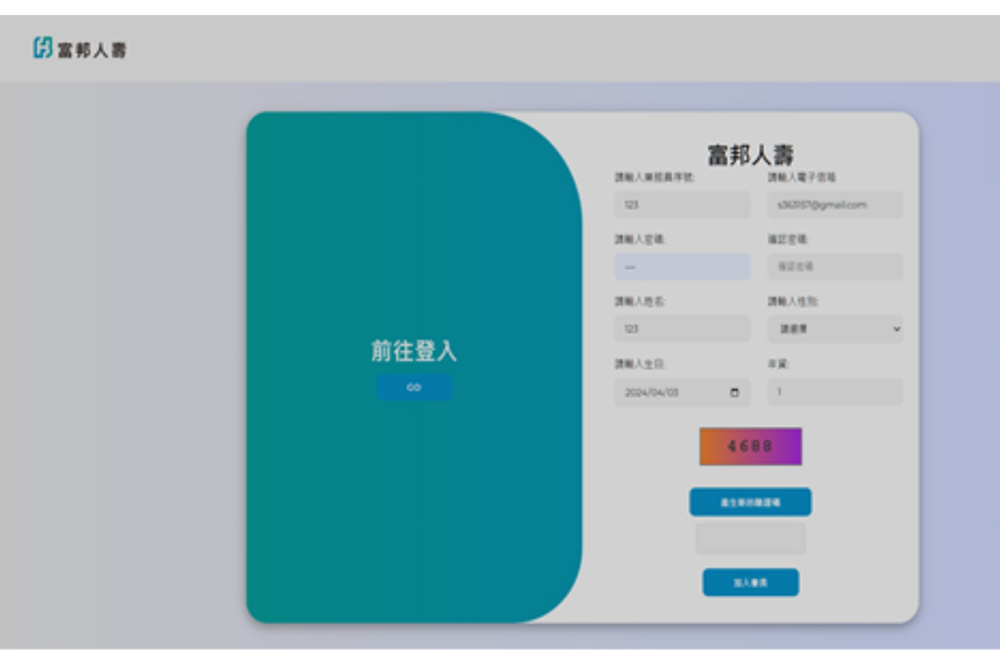
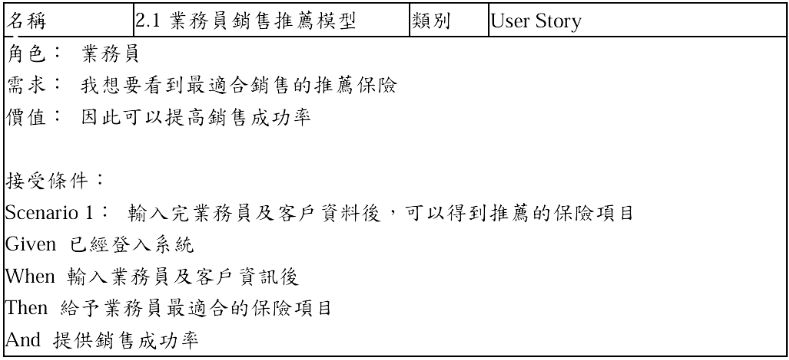
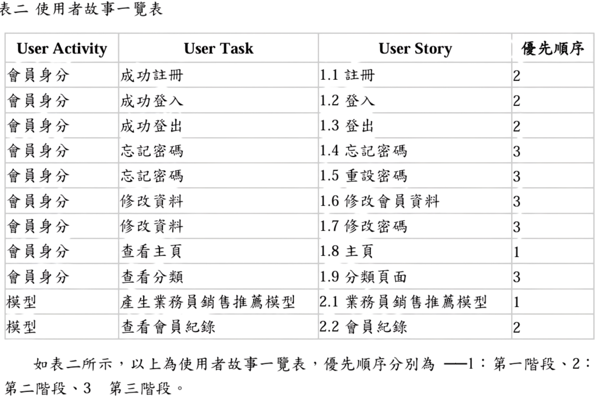
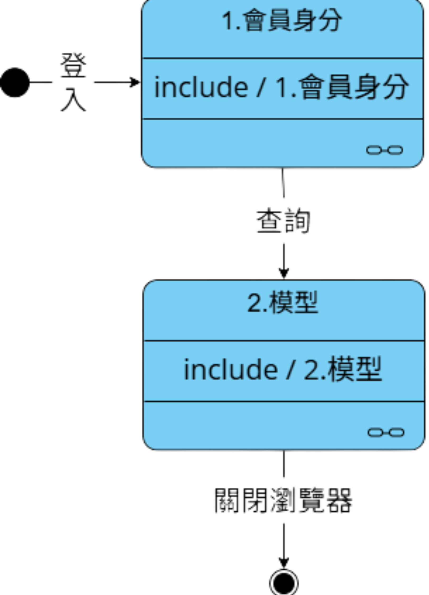
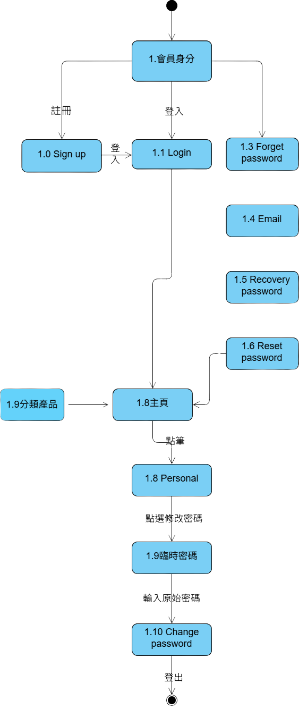
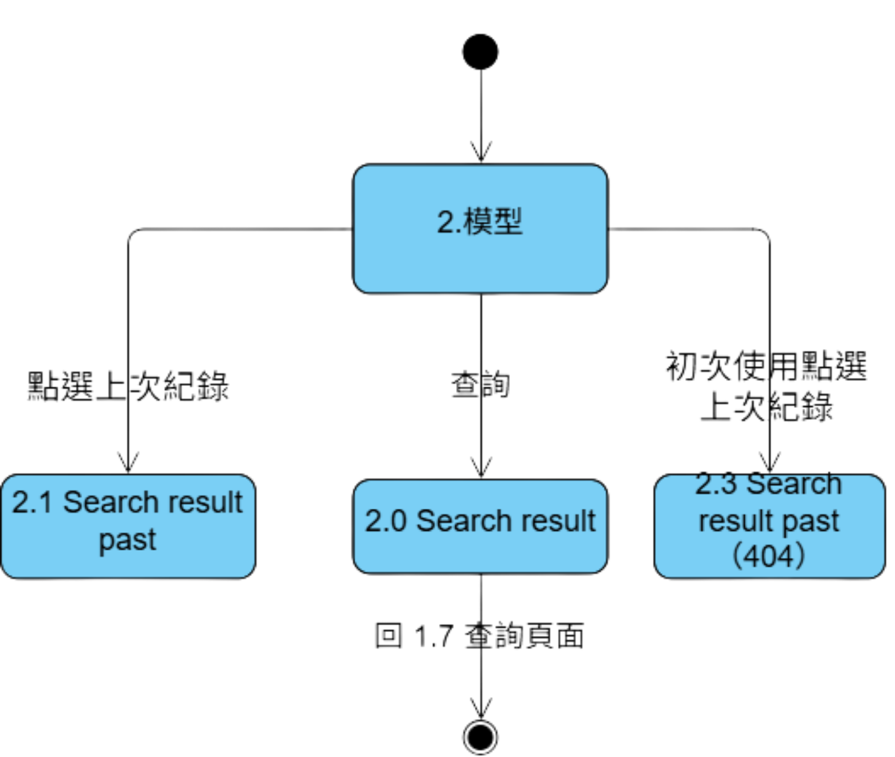
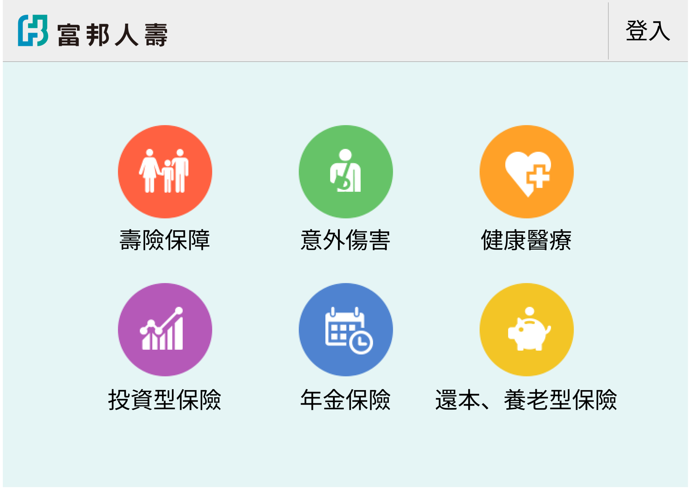

# 尋保家 Quest for Home Safety

> Project Type: UX Design / AI Product

Collaborated with an industry mentor to develop an AI insurance matching interface, using a decision tree to help sales agents quickly find the right products to recommend to customers.

---

## Project Snapshot

| Role | Team | Project Duration | Tools | System Scope |
| --- | --- | --- | --- | --- |
| Product Designer / Frontend Developer | 5 members (department capstone project) | 2023.09 – 2024.05 | Decision Tree, Figma, VS Code, phpMyAdmin, Excel, Word | Product category homepage, customer data input, decision-tree matching results page |

---

## Context

### Project Background

Before and after visiting customers, insurance sales agents need to cross-reference customers' basic information, preferences, and a large volume of policy terms to determine which product to recommend. This matching process relies heavily on each agent's personal experience and memory — less experienced agents often spend more time digging through materials, and the quality of the match can vary widely from person to person.

### Target Users

Insurance sales agents, particularly frontline staff who need to quickly compare customer profiles against product details.

### Project Goals

- Let agents complete customer data entry and product matching within a single interface, without switching between multiple documents and systems
- Replace purely experience-based judgment with a decision tree, reducing the gap in matching quality between different agents
- Let less experienced new agents quickly find suitable products to recommend, without requiring extensive training

---

## Research & Insights

### Research Methods

- Interviewed insurance sales agents to understand their actual workflow before and after customer visits
- Organized interview content into User Stories to clarify each role's expected behavior within the system

### Key Findings / Main Problems

Through interviews and User Story mapping, we found that agents' biggest pain point was "scattered data and time-consuming comparison" — customer data, policy terms, and past sales experience all live in different places, so every matching process requires re-searching and re-comparing from scratch.

### Key Insights

We focused on how to reduce the number of decision steps agents need to take and have the system provide real-time matching feedback, so agents no longer need to compare policy terms item by item themselves.

### Design Opportunities

- How might we let agents see products that match customer needs in the shortest possible time, without having to compare policy terms themselves
- How might we use a decision tree to replace word-of-mouth sales experience, so new agents can also achieve consistent matching quality
- How might we use a clearly categorized homepage to reduce the time agents spend browsing product categories

### How This Influenced the Design

From the User Stories, we found that agents cared most about "how quickly they could see recommendation results after entering data." We therefore focused our design on the shortest path — "select category → enter customer data → decision tree computation → see recommended products directly" — and used a clearly categorized homepage to reduce cognitive load while browsing.

---

## Design Process

### Process Overview

We broke down the agent's matching process into individual operational steps, categorized by System, Input, Engine (decision logic), and Output, making it easy to see at a glance where the decision tree actually sits within the flow.

1. **[SYS] Login & Permission Verification** — Agents log in with their personal account; only after verification can they access the product category homepage.
2. **[SYS] Select Insurance Category** — From the product category homepage, choose one of Accident, Medical, Life, or Savings to enter the corresponding category.
3. **[INPUT] Enter Customer Data** — Fill in required fields including age, occupation category, number of existing policies, family status, and annual income range.
4. **[ENGINE] Decision Tree Layer-by-Layer Matching** — First determines the age range, then ranks by occupational risk level, and finally cross-references gaps in existing policies to filter down to a candidate product list.｜Scenario 1・Single Product=>Directly display the matching results page.｜Scenario 2・Multiple Products=>List products sorted by premium and coverage scope, for the agent to explain to the customer.
5. **[OUTPUT] Agent's Next Steps** — Agents can go back to revise customer data and re-run the matching, or export the results for records.

### Activity Diagram

We used an activity diagram to clarify the agent's complete workflow — from login, to selecting an insurance category, to obtaining recommendation results — and to confirm the sequence between each step.

### State Diagram

- Member Identity State Diagram: Defines the login, verification, and permission state transitions of an agent's account within the system.

- Model State Diagram: Defines the state transitions of customer data from input, through decision tree computation, to output recommendation results.

### Prototype

[Figma Prototype](https://lolala.pse.is/Quest_for_Home_Safety)

---

## Solution

### Final Solution

We completed an insurance matching prototype built around a decision tree: after logging in, agents select an insurance category through a clearly categorized homepage, then enter the customer's basic information. The system then analyzes the data using the decision tree and lists the most suitable insurance products to recommend.

### Main Features

- A clearly categorized product homepage for quick navigation by insurance type
- A customer basic information input form
- A decision-tree-driven product matching results page

### Key Screens

- Homepage

Agents can click the corresponding icon to learn about different insurance categories, making product categories clearer and reducing the time agents spend searching.

- Model Matching Results

By entering the customer's basic information, the decision tree analyzes the data and calculates the insurance products suitable for recommendation.

### Design Rationale

We chose a decision tree over a more complex machine learning model because insurance product matching criteria are relatively well-defined and can be broken down into clear rules. A decision tree's logic is also easier for agents to understand and explain to customers.

---

## Impact

### Testing Approach

Due to the capstone project's timeline, we were unable to conduct formal user testing with actual sales agents. Instead, team members role-played as agents and walked through the complete flow based on the User Stories from our interviews, confirming that the decision tree's recommendation output matched our expectations.

### User Feedback

- During internal team walkthroughs, most members felt the categorized homepage effectively shortened the time needed to find products
- The decision tree's judgment criteria were still relatively simple; when customer conditions were more complex, the persuasiveness of the recommendation results needed improvement

### Iteration Focus

- Refine the decision tree's judgment criteria so recommendations align more closely with agents' actual sales logic
- Add explanations for recommendation results, so agents can explain to customers why a given product was recommended

### Results

We completed a working prototype that validated the feasibility of "using a decision tree to assist insurance matching," and presented it as our department capstone project deliverable.

### Future Improvements

- Introduce formal user testing with sales agents to validate the practicality of the decision tree's recommendations in real sales scenarios
- Expand the decision tree rules to cover a more diverse range of customer conditions and policy combinations

---

## Reflection

### What Went Well

Within the project timeline, our team completed a full prototype spanning the database, decision tree logic, and front-end interface, and successfully clarified agents' core needs through interviews and User Stories.

### What I Would Do Differently

If we had planned time for user testing early in the project, we would have had more opportunity to validate early on whether the decision tree's recommendations truly matched agents' actual sales logic, rather than relying solely on our team's internal assumptions.

### Key Learnings

- User-centered thinking: Starting from vague requirements, I learned to clarify problems through interviews rather than relying on existing assumptions.
- Communication skills: Through ongoing discussion when collaborating with others, I reduced friction and misunderstanding.
- Self-directed learning: I taught myself decision tree principles and front-end interface syntax during implementation, improving my problem-solving ability.

### Skills Demonstrated

- Decision tree logic design and database integration (phpMyAdmin)
- Front-end interface implementation, dynamically presenting recommendation results based on decision tree output
- User interviews and User Story writing
