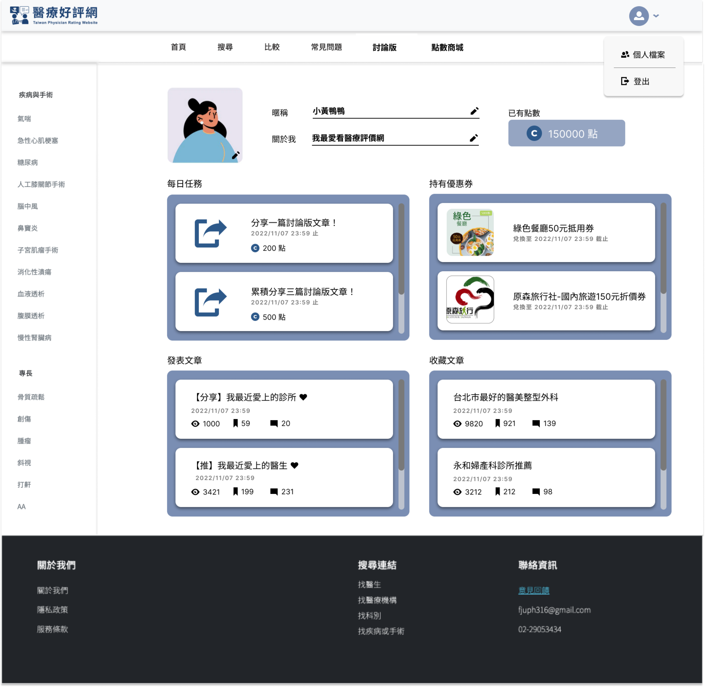
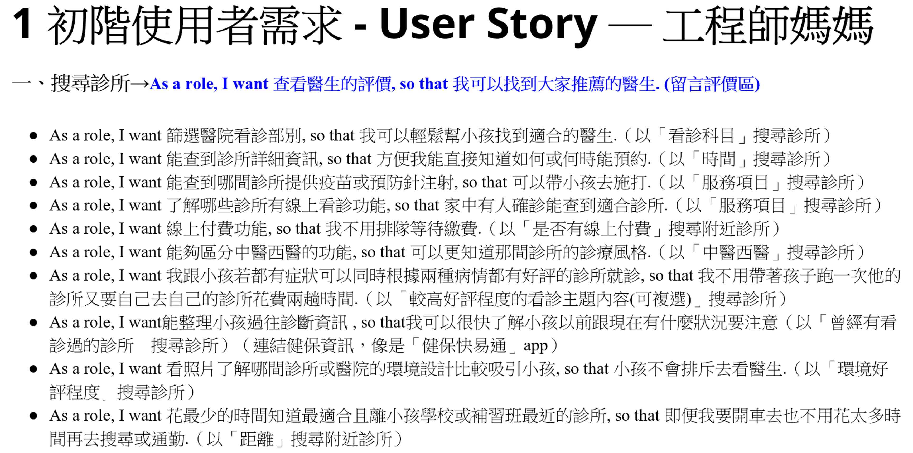
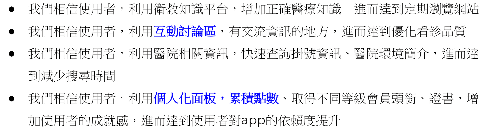
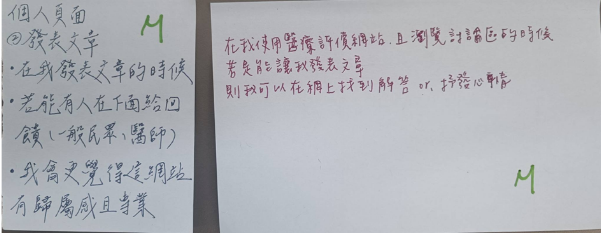

# 醫療好評網 Taiwan Physician Rating Website

> Project Type: Product Owner / UX Design

Completed a medical platform prototype, validating the navigation structure through user testing and improving search task success rate.

---

## Project Snapshot

| Role | Team | Project Duration | Tools | System Scope |
| --- | --- | --- | --- | --- |
| Product Designer / Frontend Developer | 8 people (members from Information Management, Computer Science, Psychology, and German departments) | 2023.09 – 2023.12 | Agile development, Persona, sticky notes, Figma, FB Ads | Browsing physician reviews, forum posting, points redemption |

---

## Context

### Project Background

Before seeking treatment, patients and their families often lack a trustworthy channel to learn about others' actual experiences with a doctor, making it difficult to quickly find a suitable physician.

### Target Users

Patients and their families who need medical care and want to reference others' reviews before choosing a doctor.

### Project Goals

- Two years after launch, 50% of users who have used the platform for more than six months are willing to recommend it to others
- 10% of users who have ever used the platform will proactively recommend it to others

---

## Research & Insights

### Research Methods

- Persona

- User Story

### Key Findings / Main Problems

- Hypothesis

### Key Insights

HMW: How might we get users willing to share their medical visit experiences on social media?

### Design Opportunities

- How might we get every user to leave a comment in the forum.
- How might we get the website to surpass a thousand page views.
- How might we use a health-education game to get new users to log in daily.
- Highlights

### How This Influenced the Design

Through reflecting on these simple questions, we identified the approaches and strategies that could successfully attract users to the website.

---

## Design Process

### User Test Flow

### Story Boarding

### Prototype

[Figma Prototype](https://lolala.pse.is/Taiwan_Physician_Rating_Website)

### Key Design Decisions

MoSCoW
- Used the MoSCoW framework to prioritize the order of feature development.

- Assigned time units based on the production time required for each feature.

---

## Solution

### Final Solution

[Website Simulation](https://winniekuo-1025.github.io/hoscommentweb/coupon.html)

### Main Features

### Key Screens

You can explore the actual experience through the website simulation link above. The main screens include the homepage, the physician review page, and the points redemption page. The navigation structure has been validated for search task usability in the user testing below.

---

## Impact

### Testing Approach

- Conducted usability testing interviews by posting in FB groups.
- Invited a total of 3 users from different backgrounds to complete task-based testing (posting, commenting, sharing, points redemption).

### User Feedback

- All 3 users felt uncertain about whether they had completed the posting and redemption flows.
- This was mainly due to insufficient feedback prompts.

### Iteration Focus

- Prioritized adding real-time feedback notifications after actions were completed in the posting and redemption flows.

### Results

Completed usability testing with 3 users, validating that the navigation structure was feasible, and specifically identified "insufficient action feedback" as an issue to improve, making it the priority for the next iteration.

### Future Improvements

- When a user completes an action, a notification will pop up to confirm that the action has been completed.

---

## Reflection

### What Went Well

Our cross-disciplinary team (Information Management, Computer Science, Psychology, and German departments) successfully integrated each other's perspectives. Using MoSCoW prioritization made the development order clearer, and we completed usability testing on schedule and obtained concrete user feedback.

### What I Would Do Differently

During testing, we found that insufficient feedback prompts left users uncertain about whether an action had been completed. If we had added complete action feedback prompts at the prototype stage, the test results would have been closer to the actual product experience. We would also consider inviting more users to participate in testing to obtain more comprehensive results.

### Key Learnings

- Time management: Learned to discuss and produce work during fragmented time slots, and to converge on key features within tight deadlines.
- Leadership: Learned to communicate and coordinate ideas with teammates from different backgrounds by adapting perspective and language.
- Communication & comprehension: When unable to understand what the instructor required, learned to ask more questions and listen more carefully to understand.

### Skills Demonstrated

- User research: Building Personas and User Stories, and hypothesis validation
- Prioritization decisions: Using the MoSCoW framework to prioritize feature development
- Usability test design and execution, user feedback analysis
- Cross-disciplinary team collaboration and Agile development process
