# 衛了教你餵母乳 The Nurture Way

> Project Type: Service Design / App Design

A gamified app designed to keep users engaged over the long term, awarded the InnoConnect+ Gold Award.

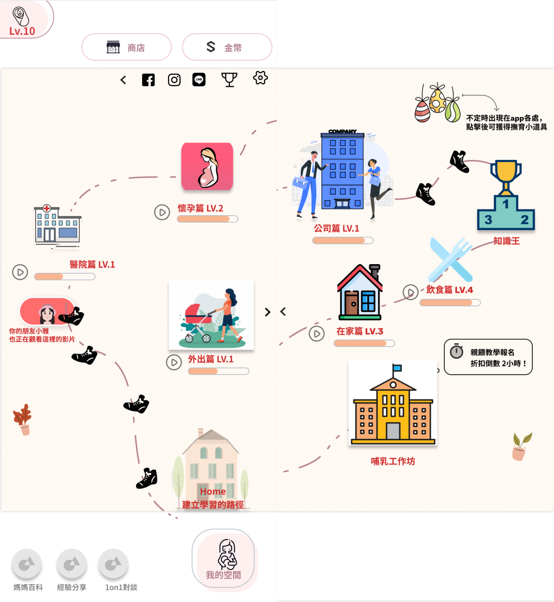

---

## Project Snapshot

| Role | Team | Project Duration | Tools | System Scope |
| --- | --- | --- | --- | --- |
| UX Researcher / Product Designer | 4 members (Information Management, Computer Science, Textiles, and German Studies) | 2021.08 – 2022.01 | Octalysis Gamification Framework, Miro, Figma | Breastfeeding education videos and knowledge PK, mom community, coins and customizable virtual baby |

---

## Context

### Project Background

Breastfeeding offers many benefits for both mother and baby, but in practice it faces three problems:

- Taiwan's exclusive breastfeeding rate within 6 months was only about 50% in 2016 — there's still room for improvement, and preparation for breastfeeding knowledge and confidence should start during pregnancy rather than waiting until after birth.
- Current prenatal education is mostly delivered through verbal, written, or video "lectures," giving pregnant women little chance to practice hands-on, which makes it hard to build lasting confidence and knowledge.
- When breastfeeding education is insufficient, pregnant women tend to lack confidence in breastfeeding, making it harder to sustain the behavior after birth and increasing the likelihood of switching to formula.

As the leading domestic brand in breastfeeding-related products, Mamaway has long invested in breastfeeding education (such as mom classes and breastfeeding/parenting encyclopedias), but providing products and online education purely from a vendor's perspective still makes it hard to keep potential customers (pregnant mothers) engaged with the educational content long term. If mothers could be drawn into using an education app as early as the start of pregnancy, building breastfeeding knowledge and confidence, they would be far more likely to keep breastfeeding — and the brand would in turn earn a reasonable commercial return. This is why the design of the education app is so critical.

### Target Users

New parents

### Project Goals

- Build a breastfeeding education app using gamified design (the Octalysis Framework).
- Guide potential customers through three stages — discovery, onboarding, and sustained engagement with the education app.

---

## Research & Insights

### Research Methods

- Persona

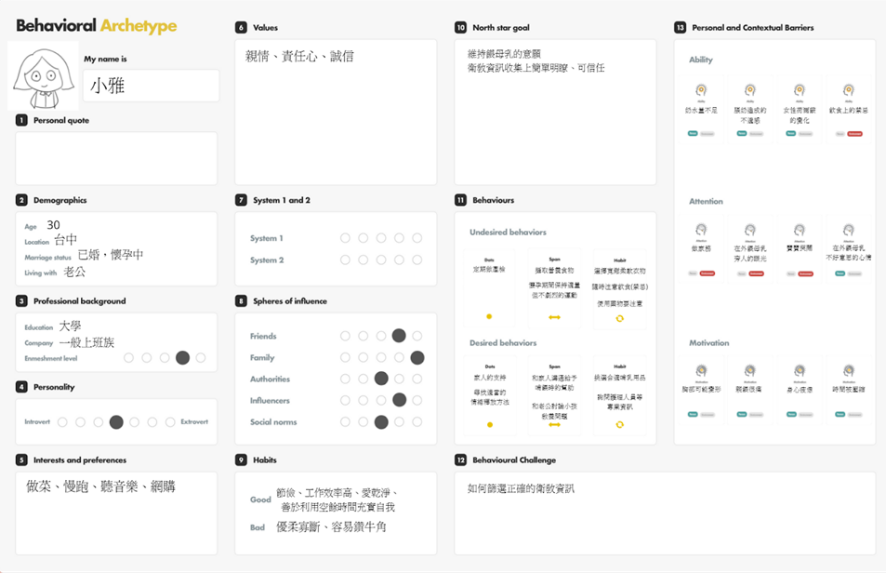

Xiaoya is a 30-year-old mother in early pregnancy who became interested in breastfeeding after encountering related information during a prenatal checkup. Between work, she has to use scattered bits of free time to search for breastfeeding information online, but there's too much information to sort through, much of it hard to verify, and other mothers' shared experiences lack evidence — leaving her feeling exhausted and anxious.

- Desktop research: pain points and gain points

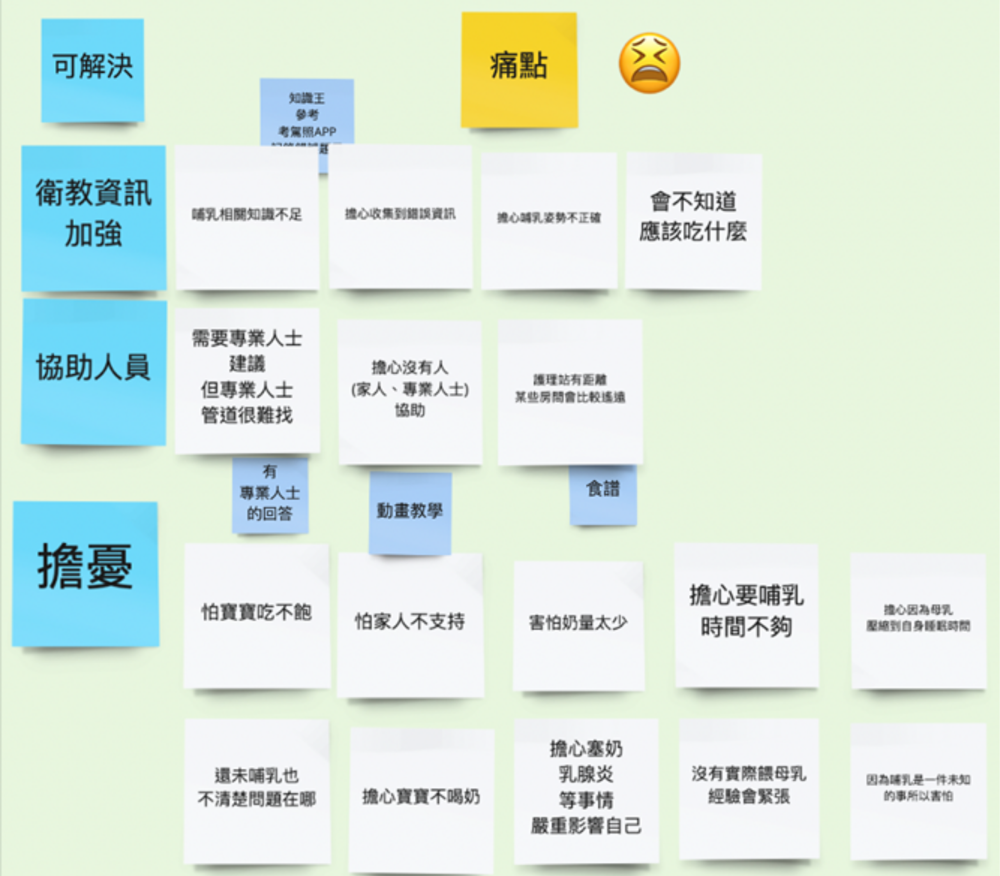

We grouped the pain points into three categories: insufficient breastfeeding education (fear of gathering incorrect information, incorrect latching posture, unclear dietary restrictions), lack of professional support (hard to find professionals, worry about having nowhere to turn in an emergency), and anxiety about breastfeeding itself (lack of family support, disrupted sleep, risk of mastitis, low self-confidence).

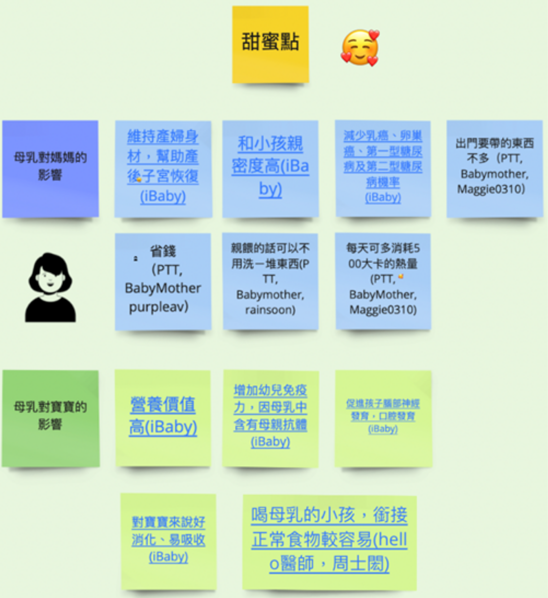

The gain points fall into benefits for the mother (lower risk of breast and ovarian cancer, cost savings, greater closeness with the baby, faster physical recovery) and benefits for the baby (stronger immunity, better brain development, lower risk of allergies) — these are the key motivators that drive mothers to persevere through breastfeeding's challenges.

- Keyword mind map

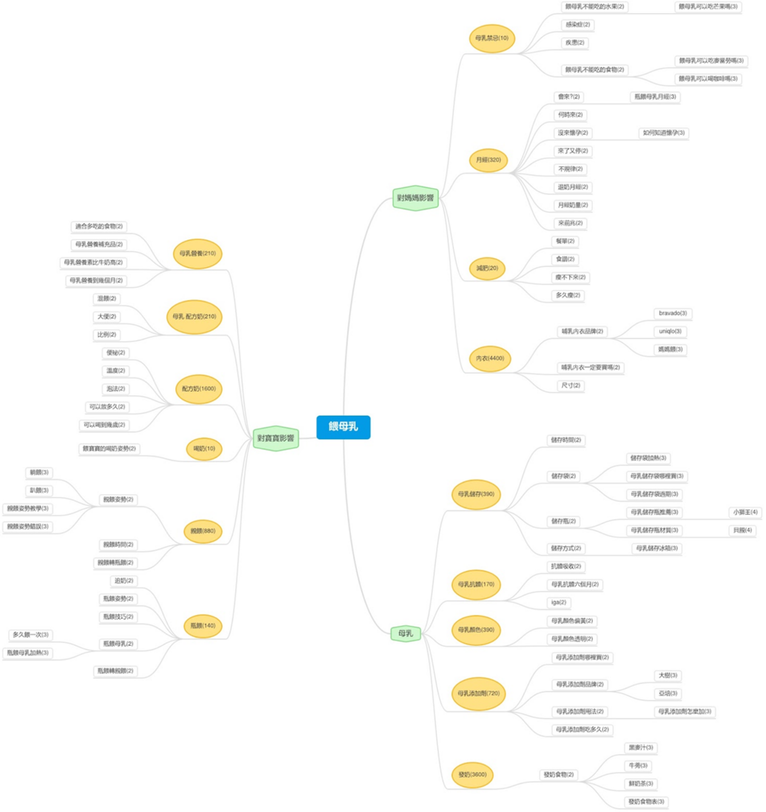

We organized keywords by pain points and gain points, then analyzed search volume with SEO tools: among topics affecting mothers, "nursing bra" and "menstruation" had the highest search volume; among topics affecting babies, "formula" had the highest search volume, with "breast milk vs. formula comparison" and "breast milk nutrition" also seeing substantial search volume — suggesting that highlighting the nutritional difference between direct breastfeeding and formula is a strong entry point for encouraging mothers to choose breastfeeding.

- Scenario flow diagram and scenario storyboard

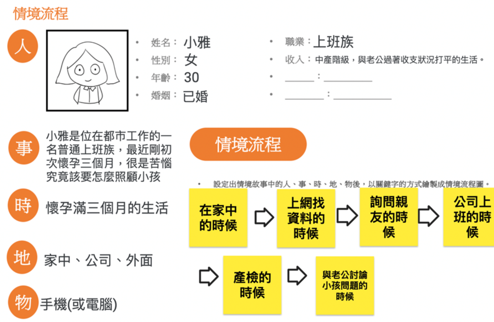

In early pregnancy, while dealing with physical discomfort, Xiaoya still has to spend her weekends searching online for how to feed her baby — but online information is scattered and unverified by experts, advice from friends and family varies case by case, and prenatal checkups only once a month can't answer her questions in real time, leaving her feeling helpless.

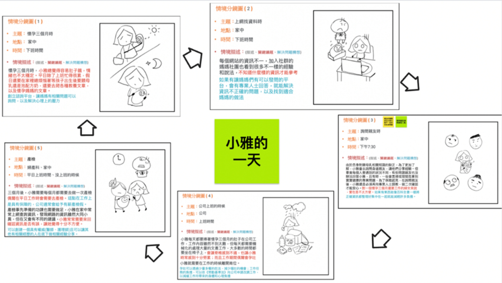

We further broke this down into five concrete scenarios: worrying about feeding methods while also researching information in early pregnancy; a large volume of hard-to-verify information online; asking friends and family whose situations differ from her own; still having to work during pregnancy while carrying a heavy physical burden; and infrequent prenatal checkups that leave questions unanswered in real time. All five scenarios point to the same underlying need: a "centralized, trustworthy" source of breastfeeding education.

### Key Findings / Main Problems

- 1. Functional
This education app is designed to save mothers the significant time they'd otherwise spend searching online for breastfeeding-related information, and to reduce the chance of encountering incorrect information. It primarily offers education videos vetted by professionals, packaged through gamified design to make otherwise dry learning content more engaging. For example, after watching an education video, mothers can head to the "Knowledge Champion" zone to compete against other users in a knowledge PK to see who knows more about breastfeeding — and the winner of each challenge earns a set number of coins. Once enough coins are accumulated, they unlock hairstyles, outfits, pants, and more, letting mothers customize their own avatar or their baby's, creating a personalized sense of ownership.
- 2. Emotional
We found that whether in pregnancy or breastfeeding, having peer support and companionship is a major source of strength for mothers, boosting their confidence and reinforcing their resolve to keep breastfeeding. That's why we built a dedicated mom community into the app, where mothers can connect and share how they're feeling. What sets this community apart from mom groups on Facebook is that every question or concern a mother raises gets answered by a professionally trained Mamaway specialist — so mothers are no longer left confused by a jumble of conflicting opinions.

### Key Insights

- If the app can quickly deliver accurate breastfeeding education to mothers, it won't just resolve most of their pain points — it will also significantly increase their willingness to breastfeed directly, which in turn boosts Mamaway's brand recognition and sales across its product line.

### Design Opportunities

We used Jobs-to-Be-Done (JTBD) quantitative analysis to rank opportunities, where a higher score indicates greater market potential. The top three were "reduce future breastfeeding mistakes caused by insufficient knowledge" (a score of 12.69), "reduce the exhaustion of dealing with a crying, hungry baby" (a score of 11.92), and "increase opportunities for nurses to demonstrate breastfeeding in person" (a score of 10.77); the remaining opportunities clustered around themes like "build confidence and closeness in direct breastfeeding" and "strengthen breastfeeding planning," scoring between 5 and 9.

Using a threshold score of 7.5 to filter opportunities, we found that potential customers' greatest market need was "preventing incorrect knowledge from taking hold" — even though education apps and websites already exist on the market, they still fail to keep potential customers engaged, and most people still end up relying on peer experience or unverified promotional content. This confirmed the content direction for our gamified education app: it should prioritize coping strategies for a crying baby, correct breastfeeding demonstrations, building confidence early in breastfeeding, and early breastfeeding planning.

### How This Influenced the Design

The JTBD analysis showed that what potential customers care about most is "preventing incorrect knowledge from taking hold" — not the existing education content already on the market. This clarified the entry point for our gamified education app: package trustworthy breastfeeding knowledge as gamified content, so that mothers stay engaged with accurate information instead of falling back on peer experience or unverified articles online. We therefore split the design into three stages — discovery, onboarding, and scaffolding — each corresponding to a stage of the mother's journey, from "discovering the product" to "returning long-term."

---

## Design Process

### Prototype

[Figma Prototype](https://lolala.pse.is/The_Nurture_Way)

### Key Design Decisions

We envisioned pregnant mothers moving through three stages of using Mamaway's gamified education app, and designed corresponding features around the Octalysis Framework's core drivers for each stage — so that every feature could be traced back to "what behavior do we want the mother to take."

**Discovery Stage**: The goal is to get mothers who encounter Mamaway's information to browse the website, interact with it, and sign up for a trial.

Expected behavior: Browse the website / read the mom encyclopedia / sign up for a mom class / view user testimonials → try the trial version → complete registration.

| # | Design Solution | Driver |
| --- | --- | --- |
| 1 | Tagline: "Your baby's health can't wait — will you do your part for the breastfeeding health of Taiwan's babies?" | Epic Meaning & Calling |
| 2 | An entry-level drag-and-drop knowledge mini-game testing basic breastfeeding knowledge | Development & Accomplishment |
| 3 | A homepage puzzle game — pass it and register to claim a reward | Empowerment of Creativity & Feedback |
| 4 | Tagline: "A good breastfeeding education tool is worth investing your time in" | Ownership & Possession |
| 5 | Twice-yearly discounts offered to pregnant mothers who subscribe for a full year | Scarcity & Impatience |
| 6 | Showcasing veteran mothers who have already earned certificates | Scarcity & Impatience |

**Onboarding Stage**: The goal is to get mothers to choose from 6 growth paths to learn along, keep them motivated to learn while tracking their own and others' progress, and introduce them to the mom community.

Expected behavior: Earn XP through learning → choose from 6 growth paths (Pregnancy / Hospital / Work / Going Out / At Home / Diet) → watch videos and leave comments → join the community and introduce yourself → follow advice from senior members.

| # | Design Solution | Driver |
| --- | --- | --- |
| 1 | Tagline: "You've been chosen to prove that Mamaway's gamified education app can change your breastfeeding life for the better" | Epic Meaning & Calling |
| 2 | Member PK (Knowledge Champion format) to test education knowledge level and earn XP | Development & Accomplishment |
| 3 | Displays growth in proficiency across each growth path | Development & Accomplishment |
| 4 | Randomly pushes three daily task videos | Development & Accomplishment |
| 5 | A growth-path radar chart that changes shape as knowledge grows | Empowerment of Creativity & Feedback |
| 6 | Take on breastfeeding knowledge challenges to earn rewards | Empowerment of Creativity & Feedback |
| 7 | Customizable learning paths that grant a certificate upon completion | Empowerment of Creativity & Feedback |
| 8 | Shows how many of a mother's Facebook friends have also joined as members | Social Influence & Relatedness |
| 9 | Open a daily time-limited question box (a daily quiz) to earn coins | Scarcity & Impatience |
| 10 | Open a surprise egg box to receive childcare props | Unpredictability & Curiosity |
| 11 | A direct-breastfeeding workshop with a discount only for time-limited registration | Loss & Avoidance |

**Scaffolding Stage**: The goal is to get mothers to keep logging in, collecting coins, and raising a virtual baby, and to keep interacting with veteran mothers who have successfully breastfed, building long-term stickiness.

Expected behavior: Log in twice a week → browse new content → collect coins (1-2 times a day) → check the dashboard for the gap to the next level → chat in the community → raise the virtual baby and purchase items from the virtual shop.

| # | Design Solution | Driver |
| --- | --- | --- |
| 1 | Option to convert a percentage (%) of coins into cash, donated to breastfeeding charities | Epic Meaning & Calling |
| 2 | Customize your own and your baby's avatar while raising the virtual baby | Empowerment of Creativity & Feedback |
| 3 | Open a treasure box for coins and childcare props after completing each unit (containing multiple question sets) | Ownership & Possession |
| 4 | Recommends the most relevant videos based on a mother's preferences within a given learning path | Ownership & Possession |
| 5 | Write experience articles on your own blog (e.g. about using a breast pump) to earn coins | Ownership & Possession |
| 6 | Daily-updated top-10 leaderboards (nearly a hundred different leaderboards, such as "most videos watched on the Diet path this week"), deliberately designed to avoid the same few users always topping the charts, so every look at the rankings feels rewarding | Development & Accomplishment |

---

## Solution

### Final Solution

We completed an education app built on the Octalysis gamification framework: pregnant mothers choose a learning path based on their needs, watch education videos and build up proficiency, and through Knowledge Champion PK battles, coin rewards, and a customizable virtual baby, learning breastfeeding knowledge becomes engaging and worth returning to — ultimately earning the InnoConnect+ Gold Award.

### Main Features

- Education videos and a proficiency system across six growth paths (Pregnancy, Hospital, Work, Going Out, At Home, Diet)
- A Knowledge Champion PK game where mothers test their breastfeeding knowledge against each other and earn XP
- A coin reward system that unlocks customizable virtual baby outfits or can be redeemed for rewards from community posts
- A dedicated mom community where trained specialists answer questions, replacing hard-to-verify information found online

### Key Screens

- Main screen & sub-screen menu
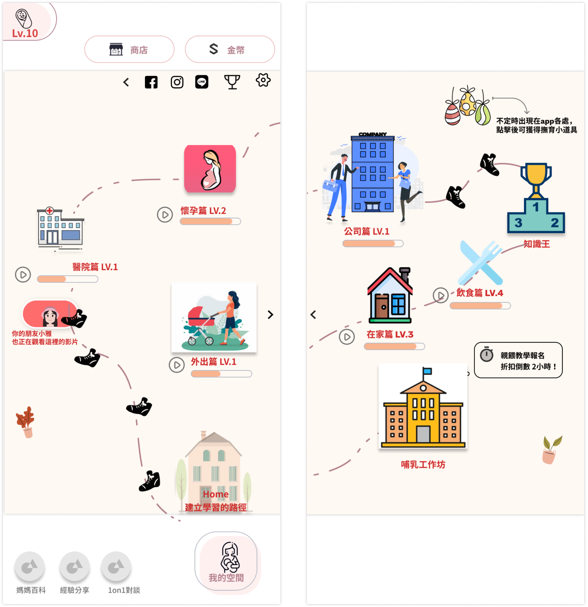
Pregnant mothers choose the learning path they like or need, customize their learning path, and earn a Knowledge Champion certificate upon completion (Onboarding Stage – Empowerment of Creativity & Feedback)

- Button guide
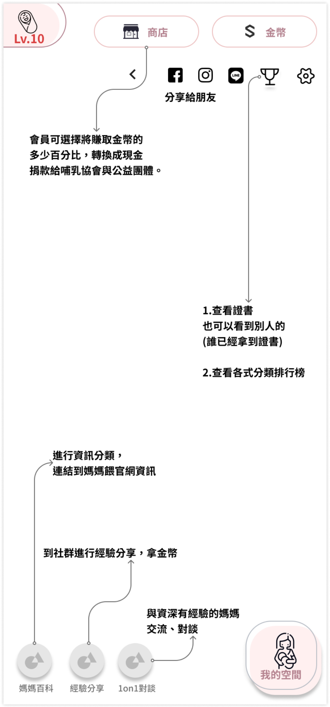
Shows veteran mothers who have already earned certificates (Discovery Stage – Scarcity & Impatience driver)
Pregnant mothers can choose what percentage (%) of their coins to convert into cash, donated to breastfeeding charities (Scaffolding Stage – Epic Meaning & Calling driver)
Write experience articles on your own blog (e.g. about using a breast pump) to earn coins (Scaffolding Stage – Ownership & Possession)

- Education video screen

Watch recommended education videos for a given path and leave comments on them (Onboarding Stage – expected behavior)

- Knowledge Champion
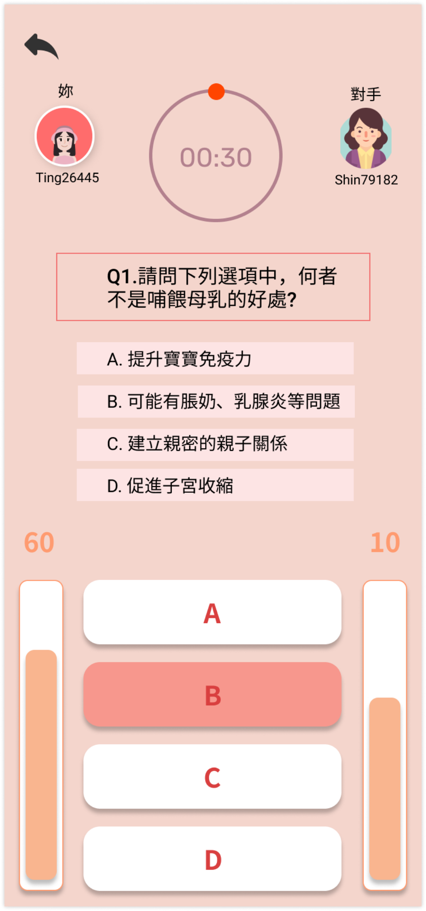
Member PK (Knowledge Champion format, testing your own breastfeeding knowledge level and earning XP) (Onboarding Stage – Development & Accomplishment driver)

- Avatar customization screen
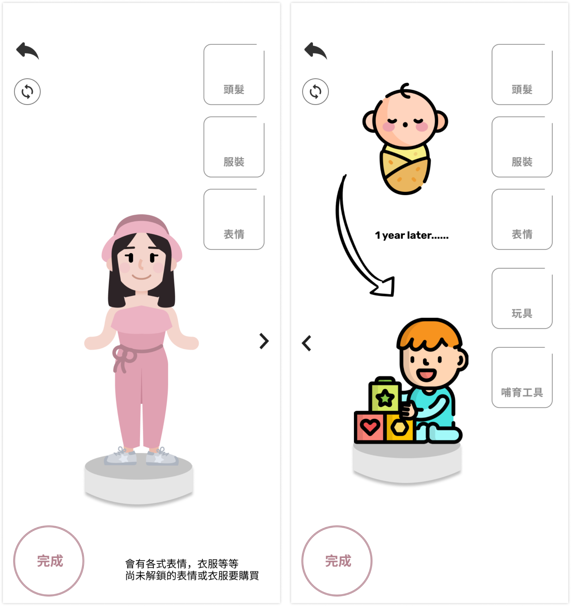
Raising the virtual baby (Scaffolding Stage – expected behavior)

### Design Rationale

Every interface feature was first mapped to "what behavior do we want the mother to take," and only then matched to a suitable Octalysis driver — avoiding features that exist only for the sake of gamification without actually helping mothers build real breastfeeding knowledge and habits.

### Why This Design

The eleven drivers of the Octalysis Framework each map to expected behaviors within the discovery, onboarding, and scaffolding stages, so that every feature design can be traced back to "what behavior do we want the mother to take" rather than gamification for its own sake.

---

## Impact

### Testing Approach

We walked through the full experience across the discovery, onboarding, and scaffolding stages using competition judges and internal team role-play, checking whether each Octalysis driver truly mapped to the intended mother behavior.

### Results

The project won the InnoConnect+ Gold Award in the corporate challenge competition, affirming the feasibility and completeness of the direction of "designing an education app with the Octalysis gamification framework."

### Future Improvements

- Conduct usability testing with real mother users to verify whether the Knowledge Champion and virtual baby mechanics actually improve long-term return rate
- Add more diverse education content scenarios (such as breastfeeding at work or while out and about) to expand coverage across the six growth paths

---

## Reflection

### What Went Well

Our team successfully translated the abstract drivers of the Octalysis Framework into concrete interface features (Knowledge Champion PK, coins, virtual baby), and the resulting project won a Gold Award in competition — proof that both the gamification design direction and its execution details were convincing.

### What I Would Do Differently

Our validation so far has relied mainly on competition judges and internal team walkthroughs. If we could bring in real pregnant mothers to test during the design phase, we'd have a much better chance of catching early on whether the gamification mechanics actually translate into long-term usage habits, rather than just completeness in the eyes of judges.

### Key Learnings

- Communication skills: learning to express opinions clearly in a remote setting when working with teammates I'd never collaborated with before.
- Cutting losses in real time: raising problems the moment they're spotted instead of putting off a solution until the last minute.
- Emotional design thinking: understanding how important emotional needs are within the overall experience.

### Skills Demonstrated

- Applying a gamification framework: breaking down user behavior with the Octalysis Framework and mapping it to interface feature design
- User behavior analysis (JTBD) and quantitative ranking of opportunities
- Cross-disciplinary remote team collaboration and project time management
