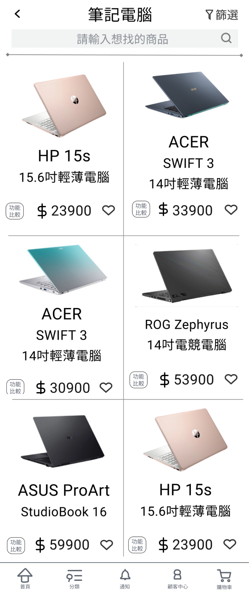
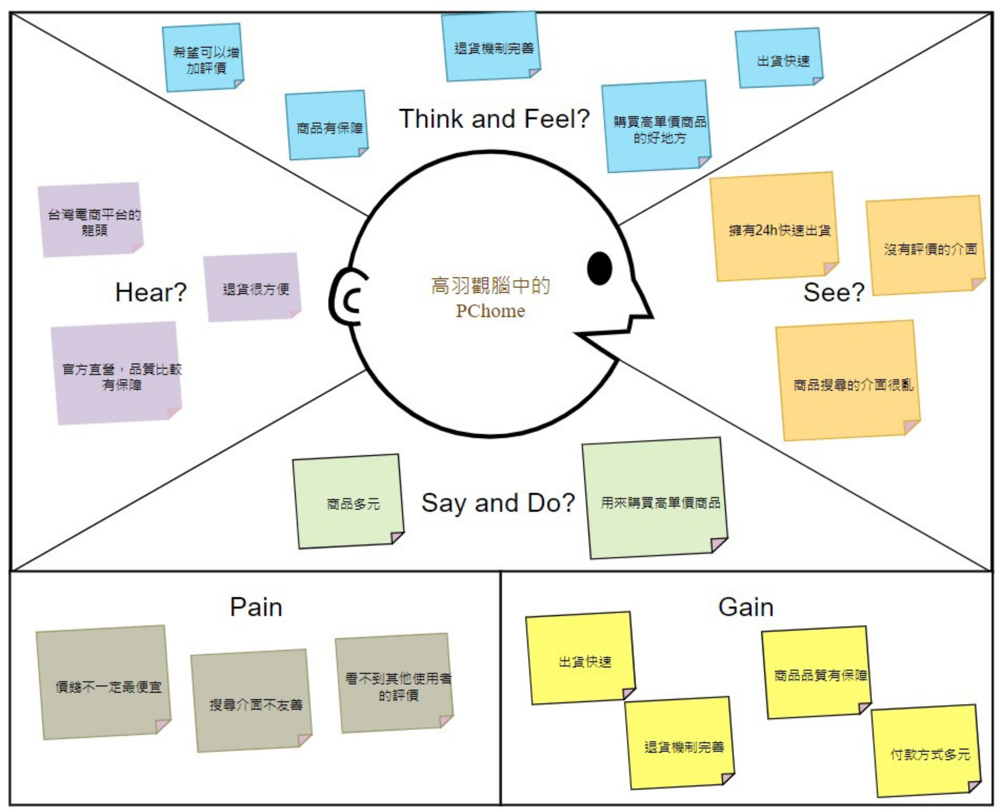
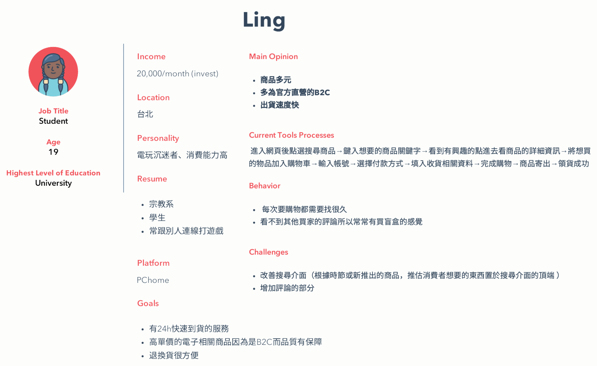
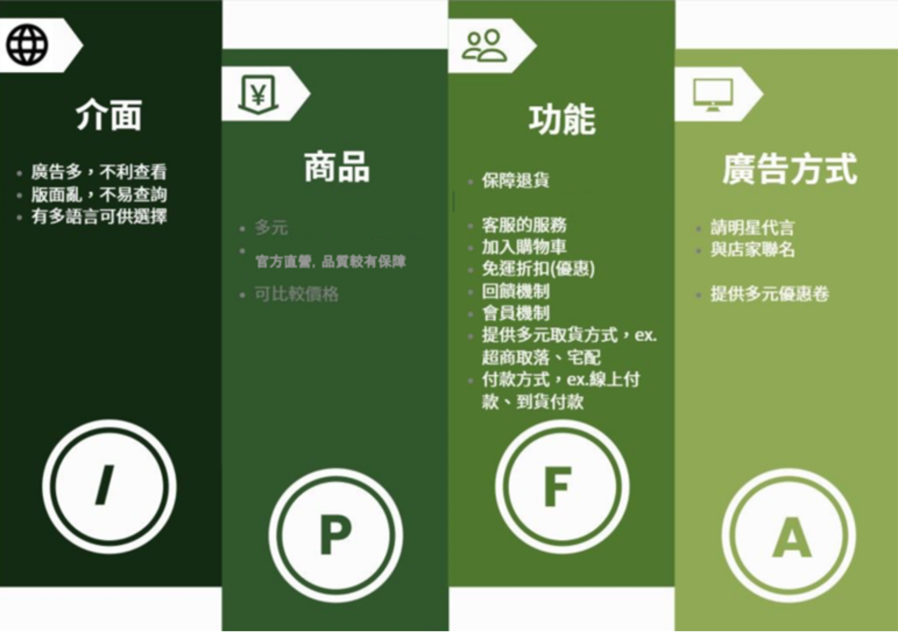
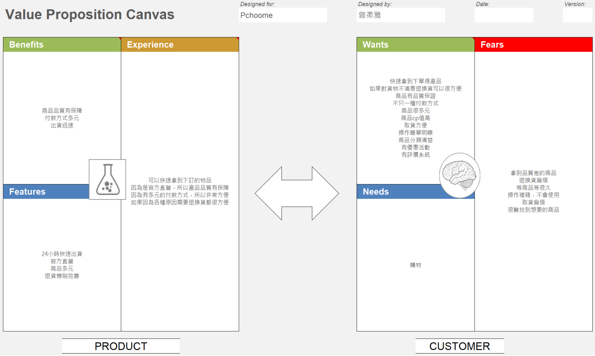
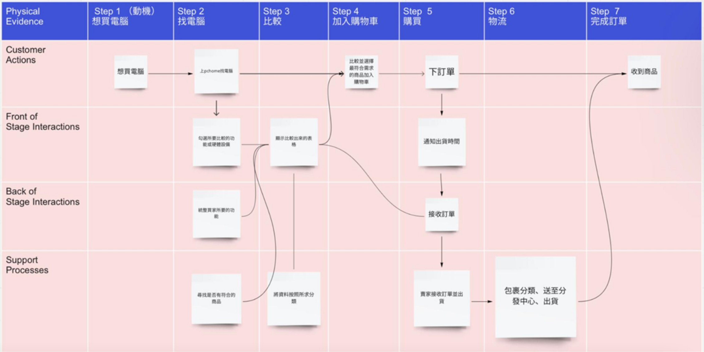
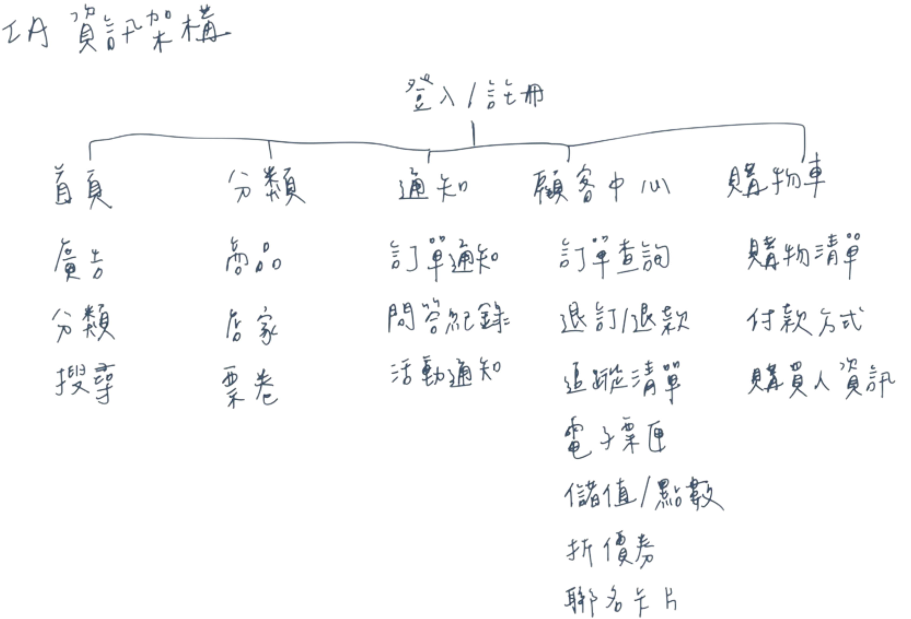
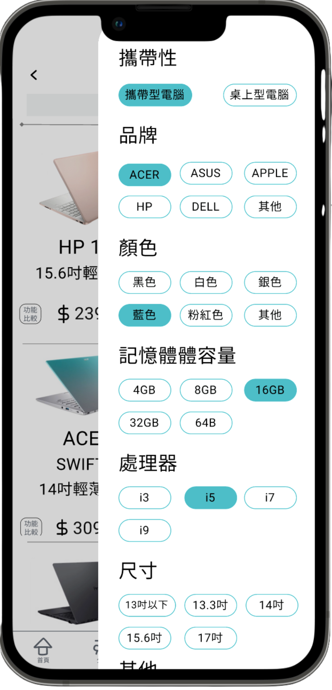
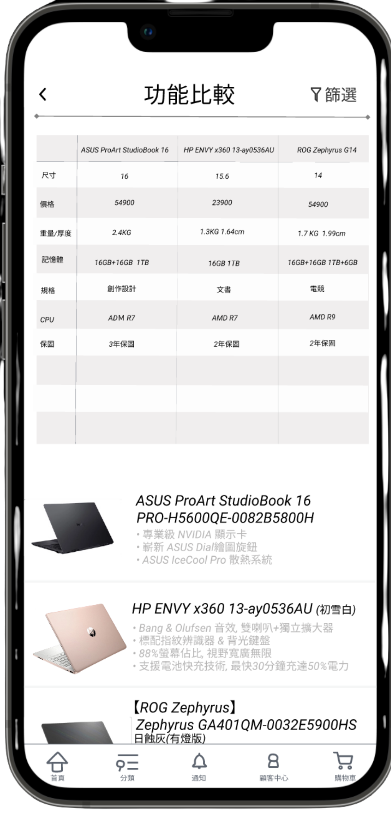

# 電商平台介面優化 Innovation and Design Thinking

> Project Type: Service Design / UX Research

Centered on service flow and usage context, we redesigned the comparison and filtering features of an e-commerce platform's interface. Scenario One reached a 97% task completion rate, and information readability improved significantly.

---

## Project Snapshot

| Role | Team | Project Duration | Tools | System Scope |
| --- | --- | --- | --- | --- |
| UX Designer / Usability Researcher | 5 people (university coursework) | 2021.09 – 2022.01 | Service Design, Miro, Figma | Single product page, customer center, shopping cart feature, order notifications |

---

## Context

### Project Background

Early in the semester, our team discussed several e-commerce platforms and chose to focus our innovation design on PChome. Although PChome is one of Taiwan's most recognized and reputable e-commerce platforms, its interface carries a heavy volume of information with unclear categorization, leaving users feeling overwhelmed every time they open it. We believed that consolidating ad placements and using icons to mark categories could greatly simplify the interface's complexity. We also considered that when shopping for electronics, users often struggle to decide because they're unfamiliar with specifications or can't remember the differences between candidate products. So we decided to design a comparison and filtering interface that lets users filter by detailed specifications or select their preferred products for side-by-side comparison.

### Target Users

Consumers who frequently shop on e-commerce platforms.

### Project Goals

- Simplify the interface and reorganize ad categories to improve overall ease of use
- Use filtering features to help customers find their desired products faster, reducing decision fatigue

---

## Research & Insights

### Research Methods

- Empathy Map

Our interviewee's existing impression of PChome was that it's Taiwan's leading e-commerce platform, with a solid return policy and official direct sales, making the purchase process feel safe with fast shipping. However, he also felt PChome lacked a review feature and that the interface was cluttered; overall he felt the platform offered diverse products but was better suited for higher-priced purchases. In summary, PChome's weaknesses were that prices weren't necessarily the lowest, the search interface was unfriendly, and there was no visibility into other users' reviews; its strengths were fast shipping, a solid return policy, guaranteed product quality, and diverse payment methods.

- Persona

Our interviewee is a student who often games with friends. With relatively high monthly living expenses and spending power slightly above average, combined with a love of gaming, he frequently uses PChome. He appreciates PChome's 24-hour fast delivery and thorough return policy (B2C model) — even at a slightly higher price, the quality and speed in urgent situations keep him choosing PChome. He sees the drawbacks as inconvenient product categorization and having to spend a long time on every purchase decision, with no buyer review feature to reference. He hopes PChome will improve its search interface and add a review mechanism.

### Key Findings / Main Problems

- Although PChome's interface supports multilingual browsing, categorization is difficult, there are too many ads, and the page is complex and cluttered, making it inconvenient and uncomfortable to use
- PChome offers diverse products with official direct sales, giving a certain level of quality assurance, and prices are comparable, which reassures customers
- PChome offers full-featured functionality — beyond the shopping cart, there are free-shipping coupons, membership benefits, multiple pickup and payment options, and a complete customer service and return system
- PChome uses diverse advertising methods, including coupons, brand co-branding, and celebrity endorsements

### Key Insights

From the Value Proposition Canvas, we identified six dimensions: Benefits (fast shipping, multiple pickup options, coupons, membership system, diverse payment methods, good quality), Features (24-hour delivery, brand partnerships, official direct sales, thorough return policy, online events), Experience (official direct sales reduces concerns about counterfeit goods, thorough returns, diverse payment methods, easy-to-reach customer service), Wants (comparison feature, high-value products, review system, simple interface), Needs (clearer product categorization, live streams or videos explaining products), and Fears (mismatch between physical product and website display, complicated operation).

### Design Opportunities

The e-commerce platform lacks a review feature, so customers can't learn about other users' actual experiences and can only rely on one-sided official claims. Adding a review mechanism would help customers better understand products and reduce the chance of buying the wrong item.

### How This Influenced the Design

Both the persona and the empathy map pointed to "complex categorization, difficulty finding desired products" as the primary pain point, while the Value Proposition Canvas also showed users craving a "comparison feature." This led us to focus our design efforts on two things: narrowing down products with more granular filter conditions, and letting users select multiple products to directly compare specifications — replacing the old approach of having to memorize details and switch back and forth between pages.

---

## Design Process

### Service Blueprint

After searching for a product, the user selects the performance and specifications they need, and the system displays a comparison table; the user can then add the product that best fits their needs to the cart and place the order. Once the seller receives the order, they sort and ship the package, and the system notifies the user of shipping progress in sync. The purpose of the selection feature is to consolidate buyer needs and present more complete comparison information organized by those needs.

### Information Architecture

### Prototype

[Figma Prototype](https://lolala.pse.is/Innovation_and_Design_Thinking)

### Key Design Decisions

- Replaced plain-text menus with icon-based categorization to reduce cognitive load when browsing large numbers of products
- Kept the filter conditions persistently anchored in the upper-right corner, so users can narrow their search at any time while browsing the product list
- Made the comparison table resizable, avoiding overly small, hard-to-read text on mobile layouts when there are too many columns

---

## Solution

### Final Solution

We completed an interface prototype that redesigns the comparison and filtering features for an e-commerce platform: users can narrow down products using the filter conditions in the upper-right corner, and add multiple products to a comparison table to view specifications, images, and features at once — replacing the previous need to switch back and forth between pages to compare.

### Main Features

- A filtering interface that lets users filter products by detailed specifications
- A specification comparison table that lists multiple products side by side
- A resizable comparison table that preserves readability on mobile layouts

### Key Screens

- Filter

In the product list found under a subcategory, users can use the filter feature in the upper-right corner to select the specifications they want and quickly find their target product.

- Feature Comparison

After selecting the products to compare, an overall specification comparison overview appears, covering the selected items and features; below that, product images, names, and highlights are shown (the comparison table can be enlarged on mobile layouts to avoid text that's too small to read).

### Design Rationale

Both the comparison table and the filtering feature directly address the core pain points identified during research — "complex categorization" and "inability to compare multiple products at once." We therefore prioritized keeping these two features usable on small screens, rather than settling for a purely visual simplification.

---

## Impact

### Testing Approach

We invited 6 testers across different age groups (15, 20, 22, 40, 45, 50 years old) to complete task-based testing, using two scenarios:

**Scenario One: Urgently needing to buy a laptop.** Testers were asked to follow the criteria "processor i5 or above, lightweight, 13 inches or larger, budget under NT$30,000," starting from the homepage, navigating to the product page, using the filter and comparison features to select a product that met the requirements, and adding it to the cart to check out. The 6 testers' task completion rates were 100%, 100%, 95%, 90%, 95%, 100% (averaging about 97%), with completion times ranging from 1 minute 23 seconds to 3 minutes 41 seconds. The main errors were unfamiliarity with what "Feature Comparison" meant, and some testers not initially thinking to use the filter feature, which led them to spend more time looking up product information one by one.

**Scenario Two: Processing a return and contacting customer service.** Testers were asked to find the customer center from the homepage's function menu, process an order return, and use the customer service feature to ask a related question. The 6 testers' task completion rates were 80%, 85%, 85%, 80%, 80%, 85% (averaging about 82.5%), with completion times ranging from 2 minutes 32 seconds to 3 minutes 41 seconds. The main issues were that testers had trouble locating the return entry point and weren't sure the customer center was tucked inside the function menu.

### User Feedback

")

- Having the main function entry points persistently anchored at the bottom of the screen made the interface convenient to use, and the overall layout felt comfortable
- Testers who previously used PChome less due to its cluttered layout said the new interface was much clearer and that they'd be willing to use it more often
- The product page was tidier than the original, and the other interfaces no longer felt cluttered
- Testers with less online shopping experience still felt the interaction could be further simplified, even though the overall experience was already easier than before
- Testers across all age groups reported that the difficulty level wasn't high, and considered it quite simple compared to other apps

### Iteration Focus

- Prioritize moving the return and customer service entry points to a more prominent, easier-to-find location
- Strengthen the interaction hints for "Feature Comparison" to reduce users' unfamiliarity with this feature

### Results

Scenario One (shopping comparison and checkout) reached a 97% task completion rate, confirming that the filtering and comparison features do effectively shorten the time needed to compare products; Scenario Two (returns and customer service) had a completion rate of about 82.5%, showing that the after-sales service flow remains a key area for optimization.

### Future Improvements

- Move the return/exchange feature to a more discoverable location, such as a prominent spot in the homepage function bar
- Add brief instructions or hints for "Feature Comparison" to lower the learning barrier for first-time use
- Provide clearer visual guidance to address the gap in operating proficiency across different age groups

---

## Reflection

### What Went Well

Our team successfully translated the pain points identified during research (complex categorization, lack of a comparison feature) into concrete filtering and comparison interfaces, and through task-based testing with 6 testers across different age groups, we gathered concrete completion-rate and timing data that validated our design direction genuinely improved the original user experience.

### What I Would Do Differently

Scenario Two's (returns and customer service) completion rate was noticeably lower than Scenario One's. If we had run an additional round of iterative testing focused on the after-sales service flow during the prototype stage, we would have had a better chance of identifying and fixing this gap before formal evaluation.

### Key Learnings

- Careful observation: Uncovering potential pain points from everyday shopping experiences, building a user-centered mindset
- The importance of defining users: Users across different age groups have different interaction habits, requiring a clear definition of the target group's characteristics
- Validating with data: Quantifying usability issues through task completion rates and completion times is more persuasive than relying on subjective impressions alone

### Skills Demonstrated

- Service Blueprint and Information Architecture design
- Usability test design and execution, including task completion rate and SUS scale analysis
- Integrated use of user research methods such as empathy maps, personas, and value proposition canvases
