# 柔雅老師的資訊柑仔店 Lola's IT Class Website

> Project Type: UX Research / Usability Testing / AI-Assisted Development

A course website I designed and built for my junior high IT classes, and one that my students use every lesson. I built a usability test into the lessons themselves, found where students got stuck across 18 classes in Grades 7 and 8, and then shipped the first redesign myself.

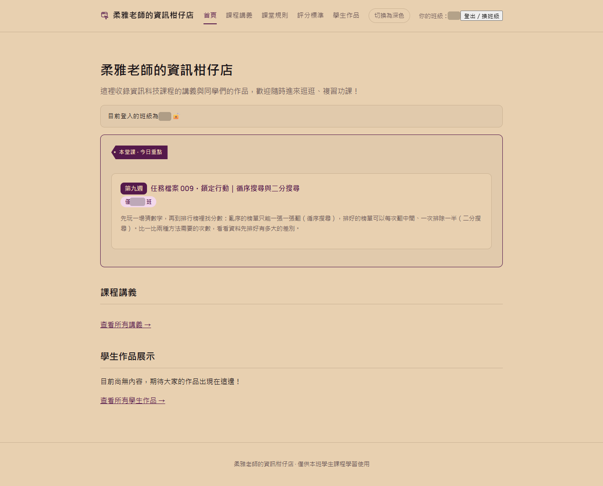

---

## Project Snapshot

| Role | Team | Project Duration | Tools | System Scope |
| --- | --- | --- | --- | --- |
| Teacher / Website Designer & Developer / Research Designer | Solo Project (AI-assisted) | 2026/10 - Present | Astro, GitHub Pages, Google Forms, Claude Code | 18 classes, Grades 7 & 8 |

---

## Context

### Project Background

Lola's IT Class Website (Chinese name: 柔雅老師的資訊柑仔店) is a course website I built with Astro and deployed on GitHub Pages ([visit the site](https://lolalayaya.github.io/Teaching/)). It hosts weekly lesson pages, interactive challenges, and assignment submission links. Students log in with a class password, and the site is used in every IT lesson.

I had three roles in this project: **the teacher** (I watch students use the site every week), **the designer and developer** (I implement and ship every change myself), and **the research designer** (I decide what to test and how to score it). Because those roles overlap, the study had to deal carefully with a known bias: students may not feel free to criticize something their teacher made.

### Target Users

- **Grade 8 (8 classes)**: learning Scratch programming (lists, sorting, searching) and submitting work to Scratchy, an auto-grading tool I built separately.
- **Grade 7 (10 classes)**: working on a data-handling project with Google Forms and Google Sheets.

Every week, both grades move between the website, Google Forms, Scratchy, and the Scratch website. The service is more than the website itself, and the handoffs between platforms are where it most often breaks.

### Project Goals

- **Find where students actually get stuck**, guided by three research questions: Can they find things? Where does the flow break, especially when jumping to external platforms? How usable is the site overall?
- **Run the study without taking up an extra lesson**: every student takes part, but the tasks double as review of the lesson content, so the study never feels unrelated to learning.
- **Turn findings into a shipped redesign**, keeping the pre-redesign version as a baseline for a retest at the end of the semester.

---

## Research & Insights

### Research Methods

- **Built into the lessons**: each task asked students to find something on the site and copy down a "verification answer." While copying answers, students were reviewing lesson content, and I was collecting navigation data. Grade 8 did it as the warm-up for their Week 7 selection sort lesson; Grade 7 did it in Week 8.
- **Task testing with verification answers**: each student completed 4 find-the-information tasks. Every verification answer had to be **text students could copy straight from the page**, with no understanding required. That way, a wrong answer could be traced to either "couldn't find the page" or "couldn't read the content." Each task also asked "Did you find it?" and "How hard was it to find (1–5)?", so self-reports and actual performance were recorded separately.
- **SUS (child-adapted version)**: the 10 items were rewritten for junior high readers so scores could be compared against the industry average of 68.
- **Journey emotions**: one lesson's flow was split into 6 steps (enter the site → find the lesson → read the lesson → use the form / Scratch project / interactive challenge inside it → submit → check grades or rules). For each step, students picked smooth, okay, or stuck.
- **Bug sorting (Grade 8 only)**: students wrote down problems with the site, rated their severity, and then used the selection sort they had just learned to decide what to fix first. This doubled as a transfer exercise for the algorithm.
- **Sample**: 205 responses from Grade 7; 146 responses to Form A and 130 to Form B from Grade 8, covering all 18 classes. When a student submitted twice, only the last submission was kept.

**Scoring rules**: a task counted as a success only if the verification answer proved the student had reached the right place. I scored every response by its content. **Self-reports were not used**, and neither was the form's auto-grading, because exact string matching marks students wrong for copying too much. Responses with all four tasks wrong and content that was gibberish or jokes were marked invalid, and success rates are reported both "overall" and "excluding invalid responses."

### Key Findings / Main Problems

1. **Students could find most things**: on the same whitelist task, after excluding junk responses, both grades had success rates of 85–88%.
2. **Unfamiliar external pages went unrecognized**: on the Grade 8 task that required jumping from a lesson page to Scratchy, the success rate was only 48%. 35 students said they "found it easily" but answered wrong; many had copied a file name from the lesson page and never clicked through. Yet Grade 7's jump to a spreadsheet they use every week had an 83% success rate. So the problem was "unfamiliar pages," not "leaving the site" itself.
3. **Students couldn't tell which sentence was the answer**: among Grade 7 students who found the right section, only half copied the exact example sentence. Another 26 copied the explanation below a question instead of the question itself.
4. **Students couldn't tell which week they were in**: 15 Grade 8 students copied numbers from a different week's lesson as their answer.
5. **Students couldn't follow text-only Scratch instructions**: this was the problem students wrote about most in the bug sorting task, for example "I can't really understand it from the text alone" and "Just give us screenshots." Grade 8's SUS item "I need someone's help" averaged 3.25 (on a 1–5 scale), and 18% of students got stuck on "using the Scratch project" in the journey.
6. **Unexpected finding: the button names in my lessons didn't match the Scratch interface.** The lessons said "進去看看" ("Go inside") and "匯出到你的電腦" ("Export to your computer"), but Scratch's Traditional Chinese interface actually shows "切換到程式頁面" ("See inside") and "下載到你的電腦" ("Save to your computer"). I only noticed this while capturing step-by-step screenshots with an automation tool.
7. **SUS averages**: 58.4 for Grade 7 and 44.0 for Grade 8, both below the industry average of 68. However, about 30% of students gave the same score on all ten items (excluded), and SUS was barely correlated with task performance (correlation 0.12–0.18), so I treat SUS only as a supporting metric.

**Journey: share of students who chose "stuck" (excluding invalid responses)**

| Step | Grade 7 | Grade 8 |
| --- | --- | --- |
| Enter the course site | 3% | 5% |
| Find this week's lesson | 3% | 3% |
| Read the lesson | 4% | 9% |
| **Use the form / Scratch project / interactive challenge in the lesson** | **10%** | **18%** |
| **Go submit the assignment** | **12%** | **12%** |
| Check grades or class rules | 3% | 3% |

Both grades showed the same pattern: entering the site, finding lessons, and checking rules went smoothly. Students got stuck on "using what's inside the lesson" and "submitting."

### Affinity Diagram

I clustered the open-ended answers from Grade 8's bug sorting, "What feature would you add?", and "Where did you get stuck?" into six groups, after removing gibberish and jokes. The first three clusters match the task-test findings and became the scope of this redesign. The other big theme, "more games, don't block sites," is about classroom rules, so it sits in its own cluster and was left out of the website redesign.

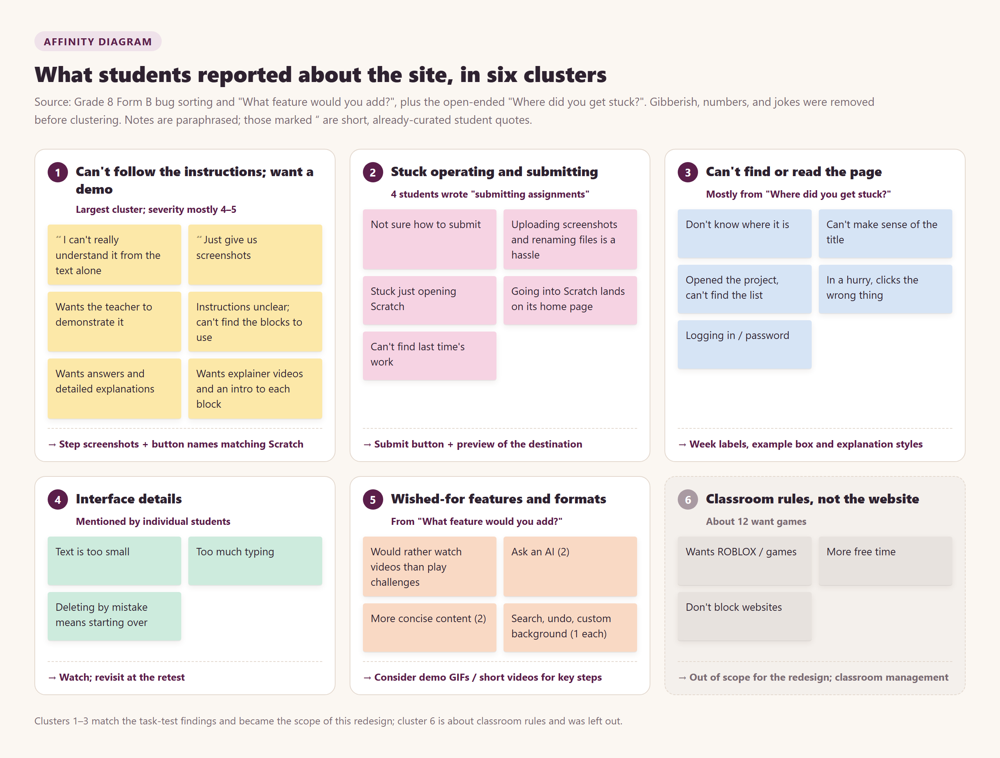

### Key Insights

- **The problem is unfamiliar pages, not leaving the site.** Both destinations were external platforms, yet the spreadsheet students use weekly was easy while the Scratchy assignment page they didn't know well was the hardest task. Students need cues that help them recognize where they've landed, not fewer jumps.
- **Students know which section holds the answer, but not which sentence.** Example sentences, questions, and explanations all shared the same text style. For junior high students there was no visual hierarchy, so finding the right section didn't mean reading the right line.
- **Self-reports are unreliable; SUS is only a supporting metric.** Every task had 15–45 students who said they found it easily but answered wrong. SUS barely reflected task performance and seemed closer to an overall attitude toward the course. The trustworthy measure was task success backed by verification answers.

### Design Opportunities

- Tell students what they'll see before they jump to an external page
- Use visual styles to separate example sentences, questions, and explanations
- Make "which week is this" visible at a glance
- Replace text-only Scratch instructions with screenshots, and match button names to the real interface

### How This Influenced the Design

I ranked the fixes by strength of evidence and breadth of impact. The Scratch instructions problem was confirmed by three data sources (the top category in bug sorting, a high SUS "need help" score, and 18% stuck in the journey), so it came first. Scratchy had the lowest task success and the biggest gap between self-report and reality, so it came second. Telling answers apart and recognizing the week came next.

Another frequent request was "more games, more free time, fewer blocked sites." That's a classroom rules issue, not a website usability issue, so I decided to leave it out of this redesign.

I mapped the candidate changes onto a severity × effort matrix: severity comes from test evidence, effort from implementation work. All four shipped changes sit on the high-impact, low-effort side. Demo videos are high impact but need recording every week, so screenshots come first and the retest will decide.

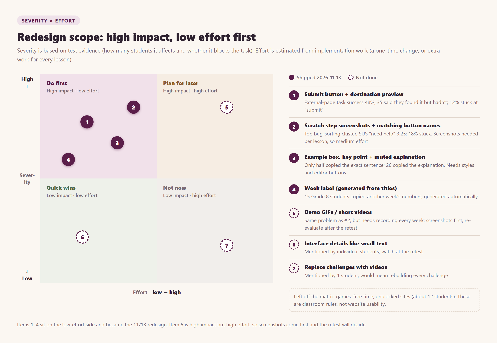

---

## Design Process

### Service Blueprint

I mapped one lesson as a service blueprint. The frontstage includes not just the website but Google Forms, Scratchy, the Scratch website, and my verbal guidance in class. Self-reported "stuck" clusters at steps 4 and 5, where the website hands off to other platforms. Steps 2 and 3 felt smooth to students, but the task tests caught problems they didn't notice: wrong week, wrong line.

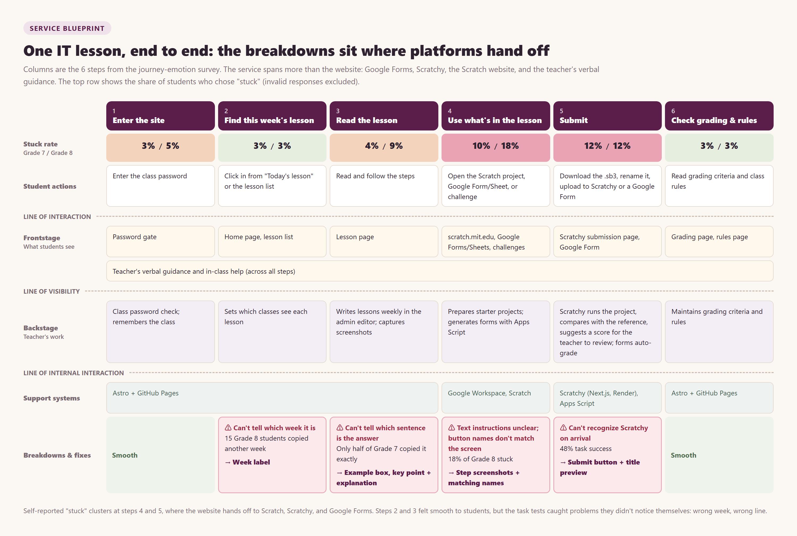

### Reflecting on the Research Method

Half of what I learned came from problems with the research method itself.

- **Students copy any example on a form.**
  - The old "Where did you get stuck?" question included examples, and many students simply copied them.
  - In bug sorting, 59% of students copied the sorting example.
  - I revised the forms right after the first class: copying of the examples disappeared, copying of the sorting example dropped to 26%, and fully correct sorts rose from 0/17 to 31% (35/113).
  - Even so, 6 students still copied a neutral instruction: "leave blank if you didn't get stuck."
  - **Design principle: a form should contain no text that could be copied as an answer.**
- **After changing "write exactly 4 problems" to "up to 4, choose 0 for any you leave blank,"** 213 fields were set to 0, and students stopped padding their answers.
- **Self-reports are unreliable**: on the Grade 8 Scratchy task, 124 students said they found it, but only 70 actually succeeded. Verification questions are essential.
- **Observation-based tasks beat recall-based surveys**: when asked to "recall problems with the site," most students left it blank or joked. The hands-on tasks clearly surfaced the real problems.
- **Limitations**: both grades answered with their names attached (so I could confirm everyone submitted), which may have made students less willing to criticize. Invalid responses made up 18% in Grade 8 and 8% in Grade 7. The lessons and forms stated that criticizing the site would not affect grades, and the usability survey was ungraded, but the effect of named responses can't be ruled out.

### AI Collaboration Process

I worked with Claude Code from research design through to the shipped redesign. Here's how the work was split:

| AI handled | I judged and decided |
| --- | --- |
| Thinking partner for research design: research questions, task structure, the child-adapted SUS items | Building the study into lessons, requiring every student to take part, verification answers that can be copied directly; named responses on both forms |
| Apps Script to generate the Google Forms; data analysis: aggregating data, computing SUS and correlations, organizing open-ended responses | **Scoring rules**: success judged by answer content rather than self-report or auto-grading, what counts as invalid, and checking the Grade 7 "document manager" task against each group's roster |
| — | Conclusions and priorities: which issues belong to the website and which (like wanting games) are classroom rules, and what to fix first |
| Implementing the four changes and adding new style buttons to the admin editor | Which finding each change addresses, what the preview text says, and mentioning "you said, I changed" verbally in class instead of in the lessons |
| Capturing before/after pages and step-by-step screenshots with an automation tool | Privacy: all analysis files are de-identified, raw responses stay in Google Sheets and never enter the repo, and the portfolio uses only aggregate data and short paraphrased quotes |

Finding 6, the mismatched button names, surfaced while capturing Scratch screenshots with the automation tool: the button names on screen didn't match what my lessons said, so students following the lessons couldn't match them to the screen. Students never wrote about this, and a survey couldn't have caught it.

### The Four Changes

| Research finding | Change |
| --- | --- |
| Scratchy not recognized; submission flow stuck | "Go submit" changed from a plain link into a consistently styled button, with a preview: "the top of the page will say 'W6 Max'" |
| Text-only Scratch instructions hard to follow | Screenshots added to the steps (buttons marked with a red box), and button names updated to match Scratch's Chinese interface |
| Couldn't tell which week it was | The "Week N" at the start of each lesson title is extracted automatically into a prominent week label (on the list, home page, and lesson pages) |
| Couldn't tell example sentences from explanations | Two new styles, an "example box" and "key point + muted explanation," plus "Example" and "Explanation" buttons in the admin editor so future lessons don't need hand-written HTML |

---

## Solution

### Final Solution

The redesign based on the test results went live on 2026-11-13. The pre-redesign version is tagged `v1-baseline` in git, and before/after screenshots of the same pages are kept for comparison at the retest.

All four changes are built as **site components or styles**, not edits to a single week's lesson. Week labels are generated from titles, and the example box and explanation styles have buttons in the admin editor, so every new lesson picks them up automatically.

### Main Features

- **Submit button + preview text**: students know what they'll see before jumping to Scratchy
- **Step screenshots + correct button names**: key Scratch steps come with screenshots, with a red box on the button to press
- **Week labels**: the week is visible at a glance on the lesson list, home page, and lesson pages
- **Example box, key point + explanation**: "the sentence to copy" is visually separated from supporting explanation

### Key Screens

- **Submit button**

**Before**: a plain text link between paragraphs. After clicking it, students weren't sure where they had landed.

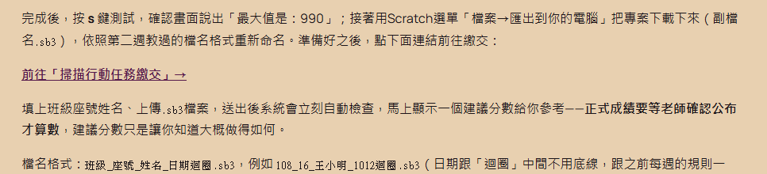

**After**: a consistently styled button, with a preview underneath: "the top of the page will say 'W6 Max'; if you see this title, you're in the right place."

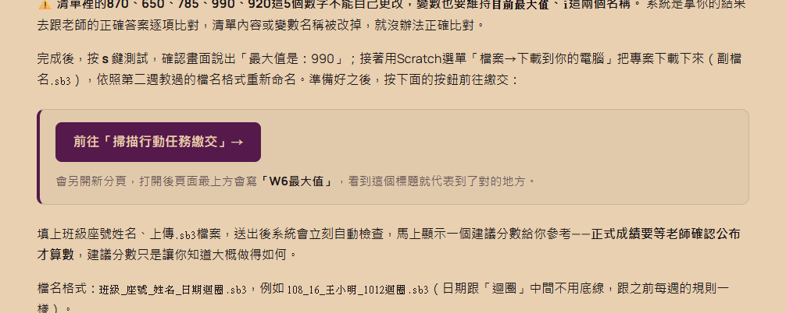

- **Scratch step screenshots**

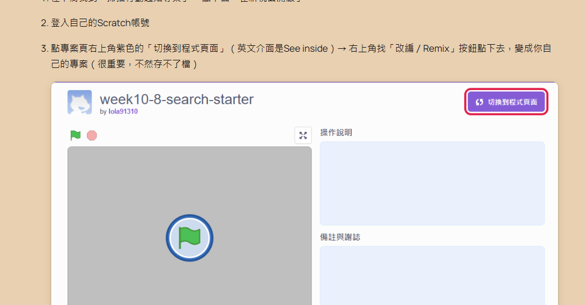

Steps now include real screenshots with a red box on the button to press. Button names match what Scratch's Traditional Chinese interface actually shows ("切換到程式頁面"), with the English interface name noted alongside.

- **Week labels**

**Before**: "第六週" (Week 6) was buried in the title text, so every week's lesson looked the same.

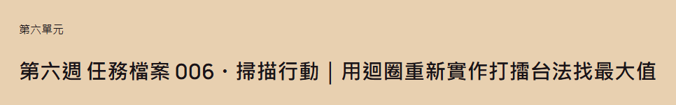

**After**: "Week N" is pulled out of the title automatically into a prominent label.

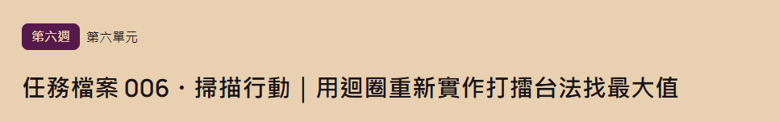

The lesson list uses the same label, so students can find this week's lesson at a glance.

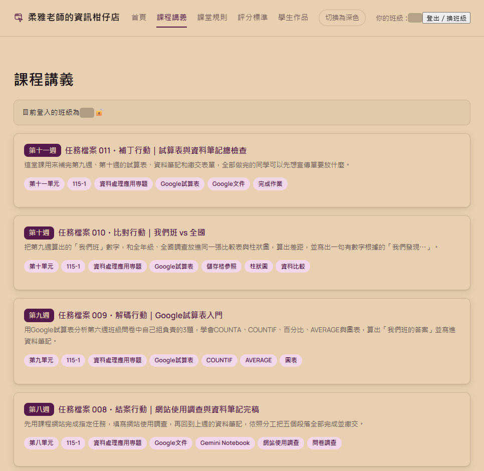

- **Example box**

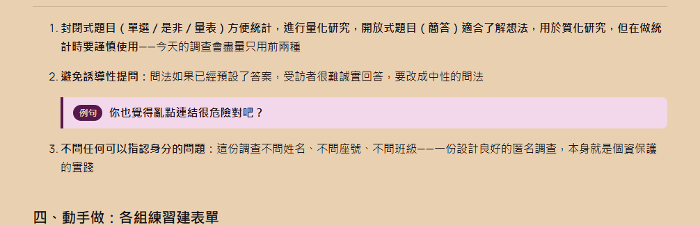

Example sentences that students should notice or copy go into a tinted box tagged "例句" (Example), clearly separated from the surrounding explanation.

- **Key point + muted explanation**

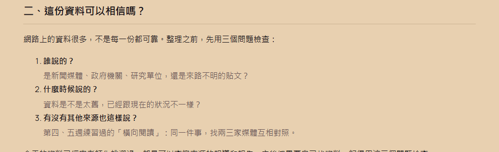

The question itself is bold, and the supporting explanation below it is muted. This targets the 26 Grade 7 students who "copied the explanation below the question instead of the question itself."

### Design Rationale

Every change maps to a finding backed by data, and each one adds cues rather than removing steps. For Scratchy, the research showed that leaving the site wasn't the problem (Grade 7 handled their spreadsheet jump easily). What students lacked was a way to recognize where they had landed, so the change previews the destination instead of reducing the number of jumps.

---

## Impact

### Testing Approach

At the end of the semester (January 2027), I'll retest with the same task types. The content will be new, since students have already seen the old answers, but each task type stays the same: find a specific sentence in a lesson, look something up in a different week's lesson, jump to an external page, and the rules page (unchanged, as a control across both tests).

Task success is the primary metric; SUS is supporting. The retest metrics and October baselines:

| Problem | Retest metric | October baseline |
| --- | --- | --- |
| Scratchy not recognized | Grade 8 external-page task success; number of "said easy but answered wrong" | 48%; 35 students |
| Couldn't tell which sentence is the answer | Grade 7 share copying only the exact answer | About half |
| Couldn't tell which week | Grade 8 students copying another week's data | 15 of 146 |
| Text-only Scratch instructions | Journey "using the Scratch project" stuck rate; SUS "need help" | 18%; 3.25 |

### Iteration Focus

The retest forms will also change based on what I learned:

- "Where did you get stuck?" has no examples or instructions, just "optional"
- A reminder before SUS: "Read every item; half of them are phrased the opposite way"
- Verification questions are scored by hand, not by quiz-mode auto-grading
- Responses stay named so the two rounds are comparable, with the limitation noted in the report

### Results

Being verified with a retest using the same task types at the end of the semester (2027/01).

### Future Improvements

- After the retest, compare task success before and after the redesign
- Some students said they'd rather watch videos than play interactive challenges, so I'll consider adding demo GIFs or short videos for key steps

---

## Reflection

### What Went Well

- **No extra lesson needed**: the tasks were framed as review, so the study didn't need its own lesson, and all 18 classes completed it.
- **Verification answer design**: because answers could be copied directly, I could tell "couldn't find it" from "couldn't understand it," and catch the gap between "said I found it" and "actually got there."
- **Turning research into a redesign myself**: the redesign went live the day the analysis was finished, built as reusable components that benefit every future lesson.

### What I Would Do Differently

- **Collect responses anonymously or semi-anonymously**: names let me confirm everyone submitted, but likely reduced criticism and encouraged a few students to answer randomly. Next time I'd consider collecting submission confirmation separately from survey content.
- **Tag the baseline and take screenshots before testing**: this time I did it on the day of the redesign. The layout matched the testing period, but a few more weeks of lessons had been added.
- **Plan the first class as a pilot from the start**: a separate pilot with a few students usually isn't feasible in class time, and this time I only discovered after the first class that the form examples were being widely copied. Next time I'll treat the first class as a planned pilot, leave time to revise the forms, and analyze that class separately.

### Key Learnings

- Junior high students copy any text on a form that looks like an answer, so research tools need usability design too.
- Self-reports and actual performance differ a lot. Usability surveys without verification questions can easily lead to wrong conclusions.
- "Leaving the site causes trouble" was my intuition, but the data showed the real issue was familiarity. Treat intuitions as hypotheses and let data test them.
- When the researcher has power over the users (teacher and students), the study design has to address that bias actively and report the limitation.

### Skills Demonstrated

- User research: task test design, SUS, journey mapping, affinity diagramming, service blueprinting, reflection on research methods
- Data analysis: defining scoring rules, de-identification, analyzing the gap between self-report and performance
- UX design: deriving changes from research findings, prioritization with a severity × effort matrix, information hierarchy and visual style design
- Development: Astro, component-based styles, admin editor features, GitHub Pages deployment
- AI collaboration: using AI to speed up research tools, analysis, and implementation, while I own scoring rules, conclusions, and privacy decisions
