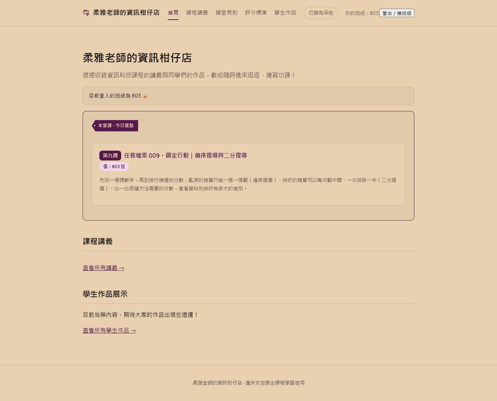
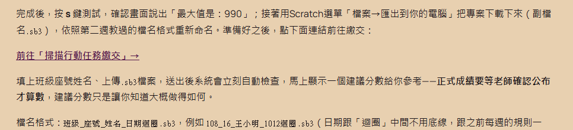
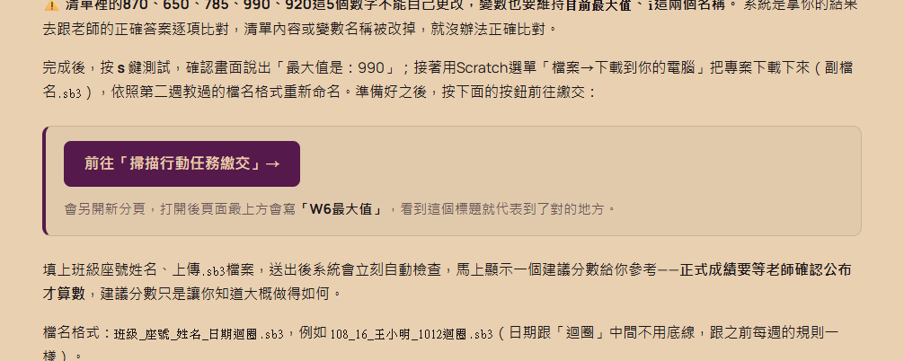
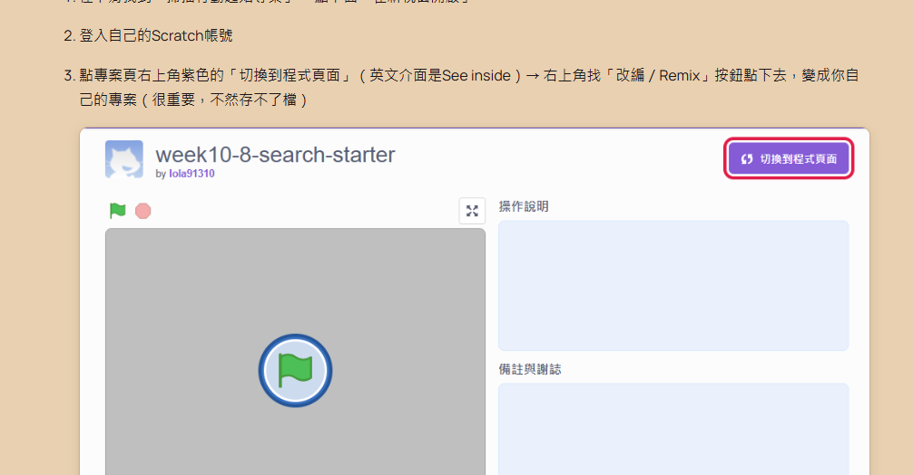
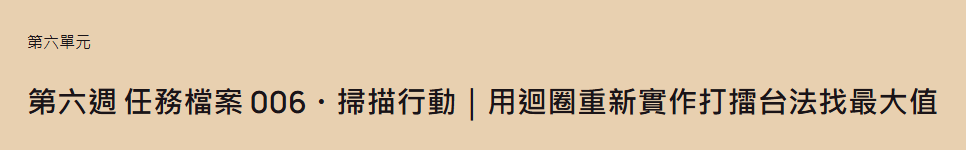
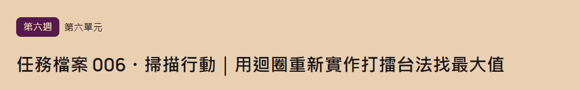
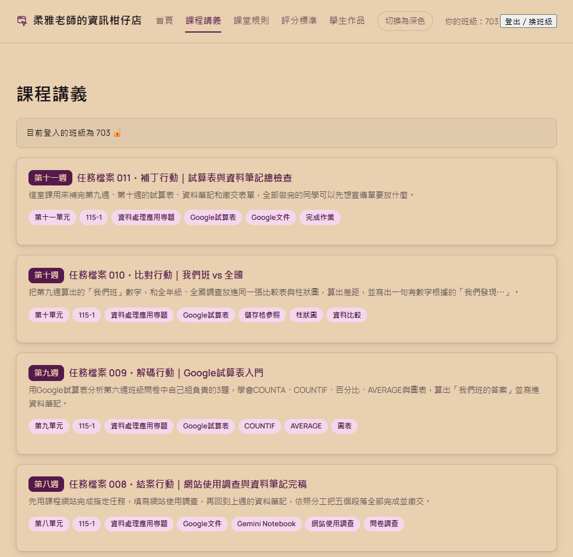
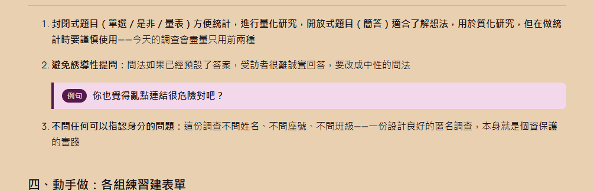
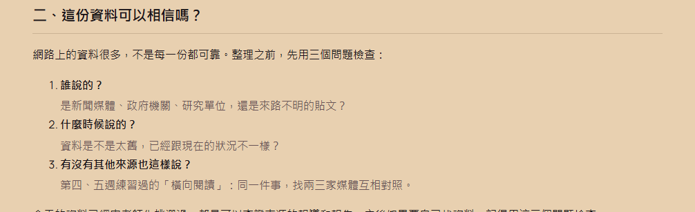

# 柔雅老師的資訊柑仔店 Lola's IT Class Website

> Project Type: UX Research / Usability Testing / AI-Assisted Development

我自己設計、開發並每天在課堂上使用的國中資訊課教學網站。這次把易用性測試包進上課內容，從 7、8 年級 18 個班的實際操作中找出學生卡住的地方，再自己把發現做成改版並上線。

---

## Project Snapshot

| Role | Team | Project Duration | Tools | System Scope |
| --- | --- | --- | --- | --- |
| 任課老師／網站設計與開發／研究設計 | 個人專案（AI 協作） | 2026/10 - 迄今 | Astro, GitHub Pages, Google 表單, Claude Code | 7、8 年級 18 個班 |

---

## Context

### Project Background

「柔雅老師的資訊柑仔店」是我用 Astro 打造、部署在 GitHub Pages 的課程網站（[網站連結](https://lolalayaya.github.io/Teaching/)）。網站放每週講義、互動闖關和作業繳交連結，學生用班級密碼登入，每堂資訊課都會用到。

這個專案裡我同時有三種身分：**任課老師**（每週看著學生使用）、**網站的設計者和開發者**（改版由我自己實作上線）、**研究的設計者**（決定要測什麼、怎麼判讀）。也因為身分重疊，研究設計要特別小心「老師問、學生不敢說」的偏誤。

### Target Users

- **8 年級（8 個班）**：在學 Scratch 程式（陣列、排序、搜尋），作業要交到我另外做的自動批改工具 Scratchy。
- **7 年級（10 個班）**：在做資料處理專題，會用到 Google 表單和試算表。

兩個年級每週都會在網站、Google 表單、Scratchy、Scratch 官網之間來回跳轉。服務不只網站本身，平台之間的交接處最容易斷掉。

### Project Goals

- **找出學生真正卡住的地方**：回答三個研究問題：找得到嗎？哪裡斷掉（特別是跳到外部平台時）？整體好不好用？
- **研究不另外占一堂課**：所有學生都要做，但任務本身就是複習上課內容，不能讓學生覺得跟學習無關。
- **把發現落實成上線的改版**，並保留改版前的基準版本，期末重測驗證。

---

## Research & Insights

### Research Methods

- **包在課程裡做**：每個任務都要學生到網站上找資料、抄下「驗證答案」。學生在抄答案的同時其實是在複習上課內容，我同時收到導覽的易用性資料。8 年級放在第七週選擇排序那堂的暖身，7 年級放在第八週。
- **任務測試＋驗證答案**：每人做 4 個找資料的任務。驗證答案必須是**頁面上可以直接抄到的字**，不需要理解就能答，這樣答錯時才分得出是「找不到頁面」還是「看不懂內容」。每題再問「找到了嗎？」和「難不難找（1～5）」，把「自評」和「實際表現」分開記錄。
- **SUS 量表（兒童改寫版）**：10 題改寫成國中生看得懂的版本，可以跟業界平均 68 分對照。
- **使用旅程情緒**：把一堂課的使用流程拆成 6 個環節（進站 → 找講義 → 看講義 → 用講義裡的表單／Scratch 專案／互動關卡 → 繳交 → 查成績或規則），每個環節選很順、普通或卡住。
- **8 年級加做 Bug 排序**：學生寫下網站問題並打嚴重度，再用剛學的選擇排序法排出「先修哪個」，同時也是選擇排序的遷移練習。
- **樣本**：7 年級 205 份；8 年級表單 A 146 份、表單 B 130 份，涵蓋全部 18 個班。同一人交兩次的只留最後一次。

**判讀規則**：任務成功與否看驗證答案是否證明學生到了對的地方，由我依答案內容逐份判讀，**不看學生自評**，也不用表單的自動計分（逐字比對會把抄太多的人判錯）。四題全錯且內容是亂碼或玩笑的，列為無效作答，成功率同時列「全部」和「排除無效後」兩個數字。

### Key Findings / Main Problems

1. **大部分東西學生都找得到**：同一題白名單任務，排除亂填之後，兩個年級的成功率都在 85～88%。
2. **陌生的外部頁面認不出來**：8 年級要從講義跳到 Scratchy 的任務，成功率只有 48%。有 35 人自評「順利找到」，其實答錯，很多人抄的是講義上的檔名，根本沒有點進去。7 年級跳到每週都在用的試算表，成功率卻有 83%。所以問題出在「陌生頁面」，而不是「跳出網站」本身。
3. **分不清哪一句才是答案**：7 年級找到正確段落的人裡，只有一半抄出精準的例句。另有 26 人抄到問題底下的說明，沒有抄到問題本身。
4. **認不出現在是第幾週**：8 年級有 15 人把別週講義的數字抄成答案。
5. **看不懂 Scratch 的文字說明**：這是學生在 Bug 排序裡寫最多的問題，例如「單看文字看不太懂」「直接截圖給我們」。8 年級 SUS「需要別人幫忙」這題平均 3.25（1～5 分），旅程中有 18% 的人卡在「使用 Scratch 專案」。
6. **意外發現：講義寫的按鈕名稱跟 Scratch 畫面不一樣**。講義寫「進去看看」「匯出到你的電腦」，但 Scratch 繁體中文介面實際顯示的是「切換到程式頁面」「下載到你的電腦」。這是我用自動化工具截操作圖時才發現的。
7. **SUS 平均**：7 年級 58.4、8 年級 44.0，都低於業界平均 68。不過約三成學生十題都選同一個分數（已排除），而且 SUS 跟任務表現幾乎沒有關聯（相關係數 0.12～0.18），所以我只把 SUS 當輔助指標。

**使用旅程（排除無效作答後，選「卡住」的比例）**

| 環節 | 7 年級 | 8 年級 |
| --- | --- | --- |
| 進入課程網站 | 3% | 5% |
| 找到這週的講義 | 3% | 3% |
| 閱讀講義內容 | 4% | 9% |
| **使用講義裡的表單／Scratch 專案／互動關卡** | **10%** | **18%** |
| **前往繳交作業** | **12%** | **12%** |
| 查成績或看課堂規則 | 3% | 3% |

兩個年級的模式一樣：進站、找講義、看規則都順，卡在「用講義裡的東西」和「交作業」。

### Key Insights

- **問題出在陌生頁面，不是跳出網站本身。** 同樣是外部平台，每週都在用的試算表很順，學生不熟的 Scratchy 作業頁卻是最難的任務。學生需要的是「到了之後認得出來」的線索，不是少一次跳轉。
- **學生知道答案在哪一段，但分不清哪一句才是答案。** 講義的例句、問題、說明都是同一種文字樣式，對國中生來說視覺上沒有層次，找到段落不等於讀對內容。
- **自評不可靠，SUS 只當輔助指標。** 「自評順利但其實答錯」每題都有 15～45 人；SUS 也幾乎反映不出操作表現，比較像是對這門課的整體態度。真正可信的是有驗證答案的任務成功率。

### Design Opportunities

- 讓學生跳到外部頁面前就知道「到了會看到什麼」
- 用視覺樣式區分例句、問題和說明
- 讓「現在是第幾週」一眼可見
- 用截圖取代 Scratch 的純文字操作說明，並讓按鈕名稱跟實際畫面一致

### How This Influenced the Design

我依「證據強度 × 影響範圍」排出改版優先順序。Scratch 操作說明有三種資料互相印證（Bug 排序第一大類、SUS「需要別人幫忙」偏高、旅程 18% 卡住），排在第一；Scratchy 的任務成功率最低、自評落差最大，排第二；接著是分不清答案和週次辨識。

學生寫最多的另一類需求是「想玩遊戲、自由時間多一點、不要限制網站」。這是課堂規則的問題，不是網站的易用性問題，我判斷不列入這次改版。

---

## Design Process

### 研究方法的反思

這次最大的收穫，有一半來自研究方法本身出的問題。

- **學生會照抄表單上的任何範例。**
  - 舊版「卡住的地方」附了舉例，結果大量學生直接照抄舉例。
  - Bug 排序有 59% 的人照抄排序範例。
  - 第一班做完之後我就改了表單：照抄舉例的情況消失；照抄排序範例降到 26%；排序全對從 0/17 升到 31%（35/113）。
  - 但連「沒有卡住就留空」這種中性說明都還有 6 人照抄。
  - **設計原則：表單上不要出現任何能直接當答案的文字。**
- **「剛好寫 4 個問題」改成「最多 4 個，沒寫的選 0」之後**，有 213 格選了 0，硬湊答案的情況不見了。
- **自評不可靠**：以 8 年級跳到 Scratchy 那題為例，124 人自評有找到，實際只有 70 人成功。驗證題是必要的。
- **觀察型任務比回想型問卷可靠**：請學生「回想網站問題」，大多是空白或玩笑；實際操作的任務卻明確抓出了問題。
- **限制**：兩個年級都記名（為了確認每個人都有交），可能讓學生比較不敢批評。無效作答佔 8 年級 18%、7 年級 8%。講義和表單都寫明「批評網站不影響成績」、網站調查完全不計分，但記名的影響仍無法排除。

### AI 協作過程

這個專案從研究設計到改版上線都有用 Claude Code 協作，分工如下：

| AI 負責 | 我判斷、決定 |
| --- | --- |
| 研究設計的討論夥伴：一起整理研究問題、任務結構、SUS 兒童改寫版題目 | 研究要包在課程裡、所有學生都要做、驗證答案必須能直接抄到；兩份表單都記名 |
| 產生 Google 表單的 Apps Script；資料分析：彙整數據、計算 SUS 與相關係數、整理開放式回答 | **判讀規則**：任務成功看答案內容而不是自評或自動計分、什麼算無效作答、7 年級「文件管理員」任務要逐一對照各組名單才算對 |
| — | 結論與優先順序：哪些是網站問題、哪些（例如想玩遊戲）是課堂規則問題、先修哪一個 |
| 實作四項改版、在後台編輯器加上新樣式按鈕 | 每項改版要解決哪個發現、預告文字要寫什麼，以及「你說→我改」只在課堂上口頭提，不寫進講義 |
| 用自動化工具截取改版前後的頁面與操作圖 | 隱私處理：分析檔一律去識別化，原始回應只留在 Google 試算表，不進 repo；作品集只用彙整數據與整理過的短句 |

第 6 項「按鈕名稱不一致」的發現，就是用自動化工具截 Scratch 操作圖時才注意到的：截圖上的按鈕名稱跟講義寫的不一樣，學生照著講義找，當然對不上畫面。這個問題學生沒有寫出來，問卷也問不到。

### 四項改版對照

| 研究發現 | 改版 |
| --- | --- |
| Scratchy 認不出來、繳交流程卡住 | 「前往繳交」從一般連結改成固定樣式的按鈕，並預告「打開後頁面最上方會寫『W6最大值』」 |
| Scratch 文字說明看不懂 | 操作步驟加上截圖（用紅框標出按鈕），按鈕名稱改成跟 Scratch 中文介面一致 |
| 認不出第幾週 | 講義標題開頭的「第○週」自動抽出來，做成醒目的週次標籤（列表、首頁、講義頁都有） |
| 分不清例句和說明 | 新增「例句框」和「重點＋淡色說明」兩種樣式，後台編輯器也加了「例句」「說明」按鈕，之後寫講義不用自己打 HTML |

---

## Solution

### Final Solution

2026-11-13 依測試結果改版上線。改版前的版本打了 git tag `v1-baseline`，並保留改版前後同一頁的截圖，期末重測時可以直接對照。

四項改版都是做成網站的**元件或樣式**，不是只改這一週的講義：週次標籤從標題自動產生，例句框和說明樣式在後台編輯器有按鈕，之後每一篇新講義都會自動套用。

### Main Features

- **繳交按鈕＋預告文字**：讓學生在跳到 Scratchy 之前就知道「到了會看到什麼」
- **操作截圖＋正確的按鈕名稱**：Scratch 關鍵步驟附截圖，紅框標出要按的地方
- **週次標籤**：在講義列表、首頁、講義頁都能一眼看出是第幾週
- **例句框、重點＋說明**：把「要抄的那一句」和「補充說明」在視覺上分開

### Key Screens

- **繳交按鈕**

**改版前**：一般的文字連結，夾在段落之間，點下去之後學生不確定自己到了哪裡。

**改版後**：固定樣式的按鈕，下方預告「打開後頁面最上方會寫『W6最大值』，看到這個標題就代表到了對的地方」。

- **Scratch 操作截圖**

操作步驟加上實際畫面截圖，紅框標出要按的按鈕；按鈕名稱改成 Scratch 繁體中文介面上真正顯示的「切換到程式頁面」，並附註英文介面的名稱。

- **週次標籤**

**改版前**：「第六週」混在標題文字裡，跟其他週的講義長得一樣。

**改版後**：「第○週」從標題自動抽出來，做成醒目的標籤。

講義列表也套用同一個標籤，學生掃一眼就能找到這週的講義。

- **例句框**

要學生注意或抄寫的例句放進有「例句」標籤的色塊，跟前後的說明文字明確分開。

- **重點＋淡色說明**

問題本身用粗體，底下的補充說明用淡色。這正好對應 7 年級有 26 人「抄到問題底下的說明，沒有抄到問題本身」的狀況。

### Design Rationale

每一項改版都對應一個有數據支持的發現，而且都選擇「給線索」而不是「減少步驟」。例如 Scratchy 的問題，研究顯示跳出網站本身不是問題（7 年級跳到試算表很順），學生缺的是「到了之後認得出來」，所以改版不是減少跳轉，而是預告目的地的樣子。

---

## Impact

### Testing Approach

期末（2027 年 1 月）會用同樣的題型重測。題目內容換新（舊答案學生已經看過），但每一題的類型維持不變：一題在講義裡找特定一句、一題指定別週的講義、一題跳到外部頁面、一題規則頁（完全不改，當作兩次測試的對照題）。

主要指標是任務成功率，SUS 只當輔助。重測要看的指標和 10 月的基準：

| 問題 | 重測要看的指標 | 10 月基準 |
| --- | --- | --- |
| 跳到 Scratchy 認不出來 | 8 年級外部頁面任務成功率、「自評順利但答錯」人數 | 48%；35 人 |
| 分不清哪一句是答案 | 7 年級「只抄出精準答案」的比例 | 約一半 |
| 認不出第幾週 | 8 年級「抄成別週資料」的人數 | 146 人中 15 人 |
| Scratch 文字說明看不懂 | 旅程「使用 Scratch 專案」卡住比例；SUS「需要別人幫忙」 | 18%；3.25 |

### Iteration Focus

依這次的教訓，重測表單也會跟著改：

- 「卡住的地方」不放任何範例或說明，只寫「選填」
- SUS 前加一句提醒：「每題都要讀，有一半是反過來問的」
- 驗證題不用測驗模式自動給分，一律人工判讀
- 維持記名，讓前後兩次可以比較，報告裡一樣註明這個限制

### Results

期末（2027/01）用同樣題型重測驗證中。

### Future Improvements

- 完成重測後，把改版前後的任務成功率做成對照
- 補做親和圖、嚴重度 × 修改成本矩陣和服務藍圖，把網站、Google 表單、Scratchy 之間的交接點畫清楚
- 有學生表示比起互動關卡更想看影片，評估在關鍵步驟加入示範 GIF 或短影片

---

## Reflection

### What Went Well

- **研究不占課**：把任務包成複習內容，沒有另外排一堂課，18 個班都做完。
- **驗證答案的設計**：因為答案能直接抄到，才分得出「找不到」和「看不懂」，也才抓得到「自評找到、其實沒到」的落差。
- **自己把研究落實成改版**：分析完成當天就改版上線，而且做成可重複使用的元件，之後每一篇講義都受益。

### What I Would Do Differently

- **改成匿名或半匿名作答**：記名是為了確認每個人都有交，但很可能讓批評變少、讓少數人故意亂填。下次會考慮用「繳交確認」和「問卷內容」分開收的方式。
- **測試前就打 baseline tag、先截圖**：這次是改版當天才補做，版面雖然跟測試期間一樣，但多了幾週的講義。
- **一開始就把第一班規劃成試做場次**：上課時通常沒辦法先找學生試做，這次是第一班做完才發現表單範例被大量照抄。下次會預先把第一班當成 pilot，預留改表單的時間，分析時也把第一班分開看。

### Key Learnings

- 國中生會照抄表單上任何看起來像答案的文字，研究工具本身也要做易用性設計。
- 自評和實際表現差很多，沒有驗證題的易用性問卷很容易得出錯誤的結論。
- 「跳出網站會卡」是直覺，但資料顯示真正的問題是熟悉度。先把直覺當假設，再讓資料驗證。
- 當研究者和使用者有權力關係（老師和學生），研究設計要主動處理這個偏誤，而且要在報告裡寫出限制。

### Skills Demonstrated

- 使用者研究：任務測試設計、SUS、使用旅程、開放式回答分類、研究方法反思
- 資料分析：判讀規則制定、去識別化、自評與實際表現的落差分析
- UX 設計：從研究發現推導改版、優先順序排定、資訊層次與視覺樣式設計
- 開發實作：Astro、元件化樣式、後台編輯器功能、GitHub Pages 部署
- AI 協作：用 AI 加速研究工具、分析與實作，判讀規則、結論和隱私處理由我把關
